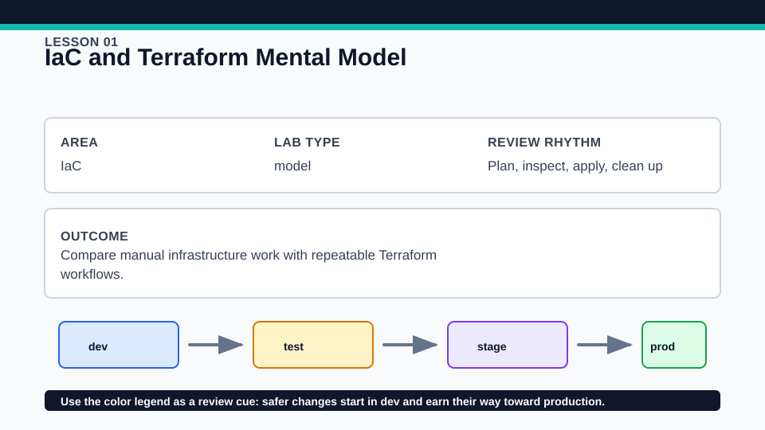
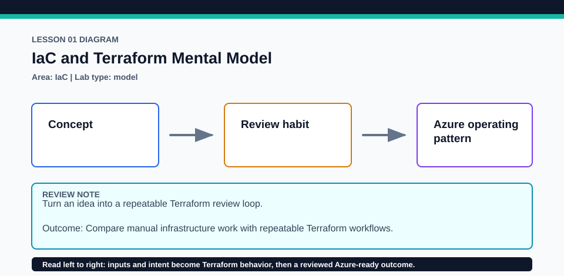

# Lesson 01: IaC and Terraform Mental Model

## Objectives
- Compare manual infrastructure work with repeatable Terraform workflows.
- Connect the lesson to Terraform Associate 004 objective area: IaC.
- Practice the habit of planning, reviewing, applying only when intentional, and cleaning up.

## Scenario
A platform team is standardizing how short-lived event environments are requested and reviewed.

## Walkthrough
Terraform is most useful when a team can explain both the desired infrastructure and the workflow around it. In this lesson, read the lab files in order: `versions.tf`, `providers.tf` when present, `variables.tf`, `main.tf`, and `outputs.tf`. Notice how names, tags, inputs, and outputs stay explicit so another engineer can review the change before it reaches Azure.

The examples are deliberately small. They are designed to teach the Terraform concept first, then connect that concept to a realistic Azure operating pattern.

## Wiki

**Concept snapshot:** Compare manual infrastructure work with repeatable Terraform workflows.

**Key terms:** `IaC`, `model`, `plan review`, `cleanup`

**Review cues:**
- Read the lab in this order: `versions.tf`, `providers.tf` when present, `variables.tf`, `main.tf`, and `outputs.tf`.
- Run `terraform fmt`, `terraform validate`, and `terraform plan` before any intentional apply.
- Use the visuals to connect the lesson concept to Azure review habits.

**Environment colors:** `dev` blue, `test` amber, `stage` violet, `prod` green.

## Lab Steps
1. Open the `lab/` folder and review the Terraform files.
2. Copy `terraform.tfvars.example` to `terraform.tfvars` if you want to override defaults.
3. Run `terraform init`, `terraform fmt`, `terraform validate`, and `terraform plan` from the `lab/` folder.
4. Apply only in a disposable Azure subscription or a safe local-only lab context.

This lab is intentionally local-first so you can practice Terraform language behavior without creating cloud resources.

## Azure Design Notes
- Well-Architected lens: name the reliability, security, cost, operational, and performance consideration before applying the lab.
- Cloud Adoption Framework discipline: keep stable identifiers in names and place ownership, cost, environment, region, and classification details in tags or metadata.
- Terraform discipline: treat the plan as the review artifact and state as sensitive operational data.
- Presenter cue: explain why the lab uses this Azure pattern and what would change for production.

## Quality Review
- Show the expected plan shape before running `terraform apply`.
- Identify one tradeoff and one failure mode a real team would discuss.
- Confirm cleanup and post-lab verification before leaving the lesson.
- Extension challenge: add one guardrail, output, validation rule, or module boundary without changing the lesson objective.

## Cleanup
- If you ran `terraform apply`, run `terraform destroy` from this lesson's `lab/` folder.
- Remove local Terraform working files with `Remove-Item -Recurse -Force .terraform` and delete `.terraform.lock.hcl` only if you do not want to keep provider selections for later.
- Do not commit real `terraform.tfvars`, state files, plan files, credentials, or generated secrets.

## Check Questions
1. Which Terraform Associate objective does this lesson reinforce?
2. Which values belong in variables, locals, and outputs in this example?
3. What would you review in the plan before allowing this change into a shared Azure environment?

