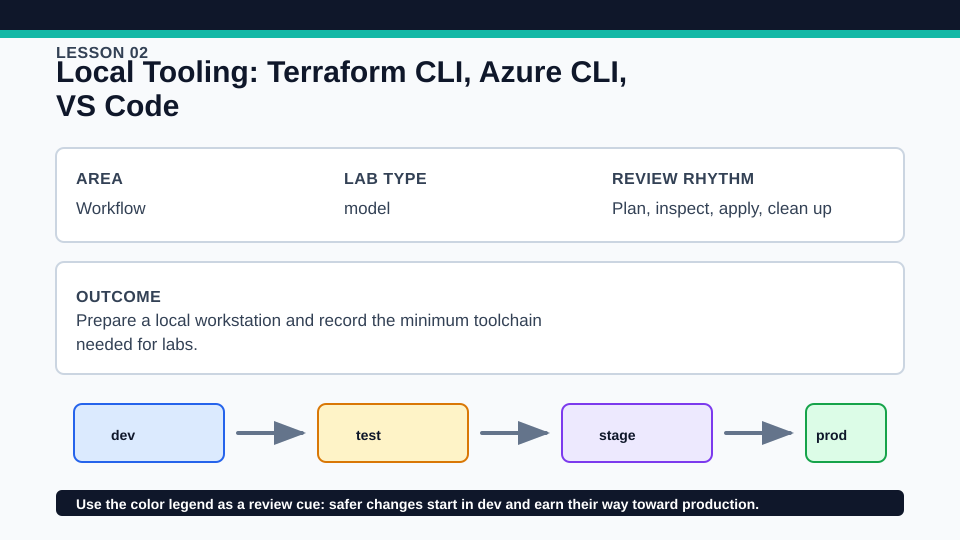
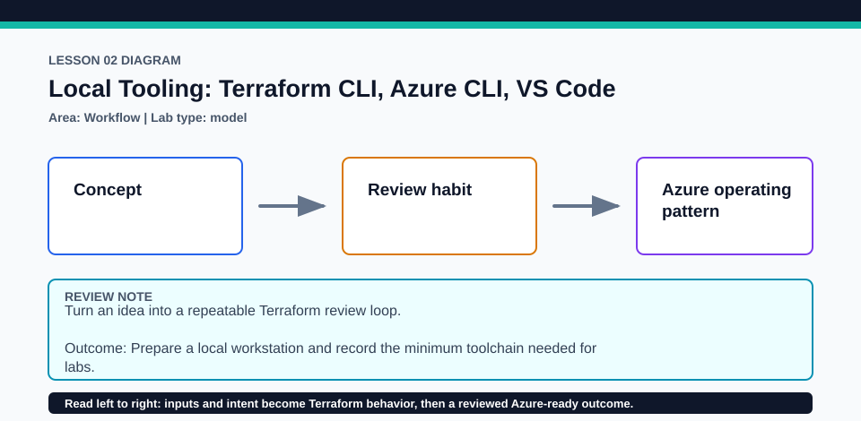

# Lesson 02: Local Tooling: Terraform CLI, Azure CLI, VS Code

This setup lesson documents the supported local workflow without upgrading workstation software automatically.

## Certification alignment

- `2a` — Install and version Terraform providers — **conceptual**: The version and command checks verify the Terraform CLI toolchain, while provider installation is reserved for Lesson 05.
- `3b` — Initialize a Terraform working directory — **guided**: The version and command checks verify the Terraform CLI toolchain, while provider installation is reserved for Lesson 05.

## Scenario

A new teammate needs a predictable setup checklist before touching shared cloud subscriptions.

## Walkthrough

1. Run terraform version and confirm it satisfies the repository constraint.
2. Run az version and compare it with the latest-tested Azure CLI recorded in course-map.yml.
3. Run az account show only if you intend to use Azure, then inspect the lab in VS Code with the Terraform extension.

Baseline commands for this lesson:

```powershell
Set-Location lab
terraform init -lockfile=readonly
terraform fmt -check
terraform validate
terraform plan
```

## Expected results

- Terraform reports a supported 1.x version.
- The local model configuration initializes, validates, and plans without Azure credentials.
- Azure account output, when requested, identifies the tenant and subscription rather than exposing a client secret.

## Failure modes

- A second Terraform executable earlier on PATH can report an unexpected version.
- Azure CLI may be installed but not authenticated or may target the wrong subscription.
- Editor diagnostics do not replace terraform validate with the real CLI.

## Wiki




## Cleanup

- Do not apply the model solely to prove the tools are installed; the plan is sufficient.
- Sign out of Azure if this was a shared workstation and remove copied local variable files.
- Remove generated `.terraform/`, plan files, state files, debug logs, copied `terraform.tfvars`, and generated secrets only after any required destroy or migration is complete.
- If this root has a committed `.terraform.lock.hcl`, keep it. Never delete a root lock file as routine cleanup; update it only during an intentional, reviewed dependency upgrade.
- Do not commit credentials, real secret values, state, plan files, backend credentials, or local variable files.

## Check questions

1. Why is terraform version checked separately from a configuration's required_version?
2. What evidence confirms the active Azure subscription?
3. Why is editor validation helpful but not authoritative?

