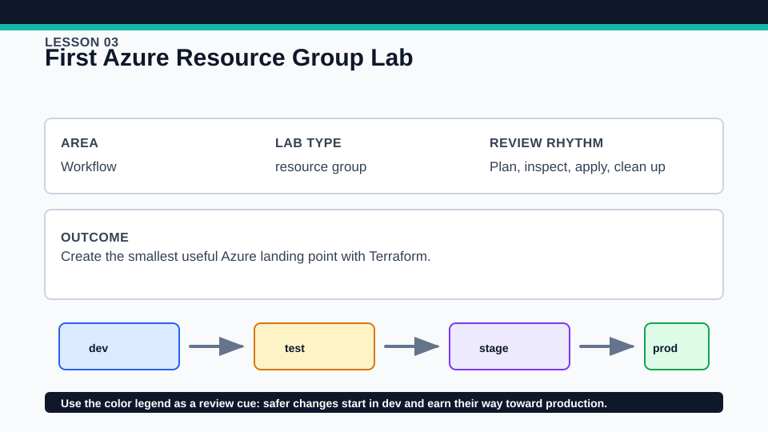
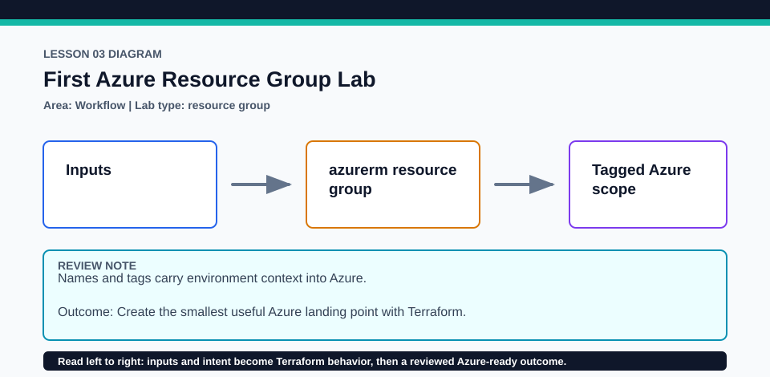

# Lesson 03: First Azure Resource Group Lab

This is the smallest Azure apply/destroy lab; keep it in a disposable subscription with a cost budget.

## Certification alignment

- `1b` — Describe the advantages of IaC patterns — **guided**: Creating and destroying one azurerm_resource_group exercises the reviewed Terraform workflow and demonstrates repeatable IaC benefits.
- `3a` — Describe the Terraform workflow — **hands-on**: Creating and destroying one azurerm_resource_group exercises the reviewed Terraform workflow and demonstrates repeatable IaC benefits.
- `3d` — Generate and review an execution plan for Terraform — **hands-on**: Creating and destroying one azurerm_resource_group exercises the reviewed Terraform workflow and demonstrates repeatable IaC benefits.
- `3e` — Apply changes to infrastructure with Terraform — **hands-on**: Creating and destroying one azurerm_resource_group exercises the reviewed Terraform workflow and demonstrates repeatable IaC benefits.
- `3f` — Destroy Terraform-managed infrastructure — **hands-on**: Creating and destroying one azurerm_resource_group exercises the reviewed Terraform workflow and demonstrates repeatable IaC benefits.

## Scenario

The team needs a disposable resource group for an event check-in proof of concept.

## Walkthrough

1. Confirm the active Azure subscription and copy only non-secret overrides into terraform.tfvars.
2. Trace how variables and locals produce the resource-group name and tags.
3. Review the saved plan, apply it only when authorized, then compare terraform output with the Azure resource group.
4. Run terraform plan again and explain why an unchanged configuration should converge to no changes.

Baseline commands for this lesson:

```powershell
az account show
Set-Location lab
Copy-Item terraform.tfvars.example terraform.tfvars
terraform init -lockfile=readonly
terraform fmt -check
terraform validate
terraform plan -out=tfplan
```

The plan is credentialed but non-mutating. Apply only in a disposable subscription after confirming the active tenant, subscription, names, region, cost, and every proposed replacement or deletion.

## Expected results

- The plan proposes one Azure resource group with the expected location and tags.
- After apply, outputs expose the managed name and ID and a second plan is empty.
- Destroy proposes removal of only the object tracked by this lesson's state.

## Failure modes

- A globally inappropriate or policy-blocked region can make the Azure API reject apply.
- Using the wrong subscription creates an otherwise valid resource in the wrong place.
- Deleting state before destroy leaves the resource group outside this workflow's management.

## Wiki




## Cleanup

- If applied, run terraform destroy and verify the resource group no longer exists before deleting local state.
- Retain the committed provider lock file for repeatable future runs.
- Remove generated `.terraform/`, plan files, state files, debug logs, copied `terraform.tfvars`, and generated secrets only after any required destroy or migration is complete.
- If this root has a committed `.terraform.lock.hcl`, keep it. Never delete a root lock file as routine cleanup; update it only during an intentional, reviewed dependency upgrade.
- Do not commit credentials, real secret values, state, plan files, backend credentials, or local variable files.

## Check questions

1. Which plan fields prove the resource group will be created in the intended subscription context?
2. What makes the second plan an idempotence check?
3. What would be lost if the state file disappeared before destroy?

