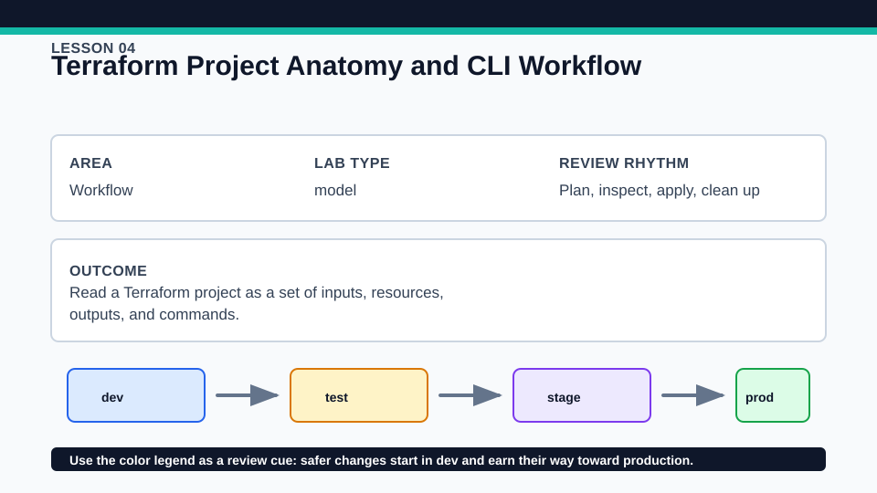
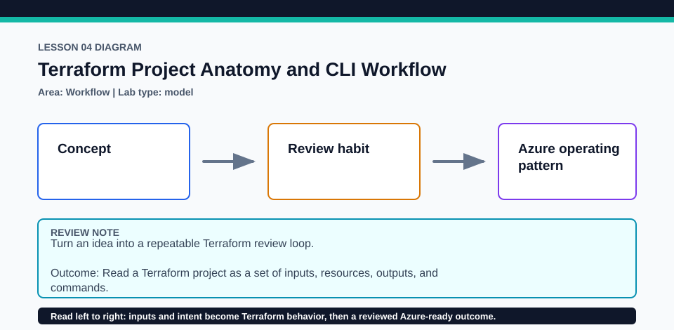

# Lesson 04: Terraform Project Anatomy and CLI Workflow

This lesson treats each CLI command as a distinct review checkpoint rather than one opaque deployment action.

## Certification alignment

- `3a` — Describe the Terraform workflow — **hands-on**: The local terraform_data project is used to run fmt, init, validate, plan, and optional apply in their normal order.
- `3b` — Initialize a Terraform working directory — **hands-on**: The local terraform_data project is used to run fmt, init, validate, plan, and optional apply in their normal order.
- `3c` — Validate a Terraform configuration — **hands-on**: The local terraform_data project is used to run fmt, init, validate, plan, and optional apply in their normal order.
- `3d` — Generate and review an execution plan for Terraform — **hands-on**: The local terraform_data project is used to run fmt, init, validate, plan, and optional apply in their normal order.
- `3g` — Apply formatting and style adjustments to a configuration — **hands-on**: The local terraform_data project is used to run fmt, init, validate, plan, and optional apply in their normal order.

## Scenario

A service-status page project is being split into predictable files for review.

## Walkthrough

1. Read the files by responsibility: versions, variables, main configuration, and outputs.
2. Intentionally add harmless spacing in a disposable copy, run terraform fmt -check, then terraform fmt and inspect the diff.
3. Run the baseline commands and save a plan in the disposable copy for terraform show.
4. Optionally apply the terraform_data contract and verify a subsequent plan reports no changes.

Baseline commands for this lesson:

```powershell
Set-Location lab
terraform init -lockfile=readonly
terraform fmt -check
terraform validate
terraform plan
```

## Expected results

- Initialization prepares the working directory without creating infrastructure.
- Validation succeeds only after syntax and internal references are valid.
- The displayed plan separates proposed actions from configuration source and state.

## Failure modes

- Running plan before init can fail when dependencies or backend setup are unavailable.
- terraform validate cannot prove a remote API will accept a future request.
- Formatting can change style but cannot repair invalid business logic.

## Wiki




## Cleanup

- If the local contract was applied, destroy it before removing its disposable state.
- Delete the disposable formatted copy and saved plan; keep tracked source and lock files.
- Remove generated `.terraform/`, plan files, state files, debug logs, copied `terraform.tfvars`, and generated secrets only after any required destroy or migration is complete.
- If this root has a committed `.terraform.lock.hcl`, keep it. Never delete a root lock file as routine cleanup; update it only during an intentional, reviewed dependency upgrade.
- Do not commit credentials, real secret values, state, plan files, backend credentials, or local variable files.

## Check questions

1. What work belongs to init that validate does not perform?
2. Why inspect a saved plan with terraform show before apply?
3. Which command should CI use to check formatting without rewriting files?

