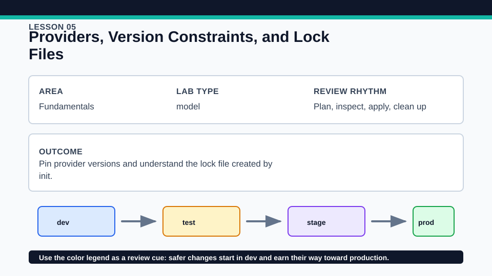
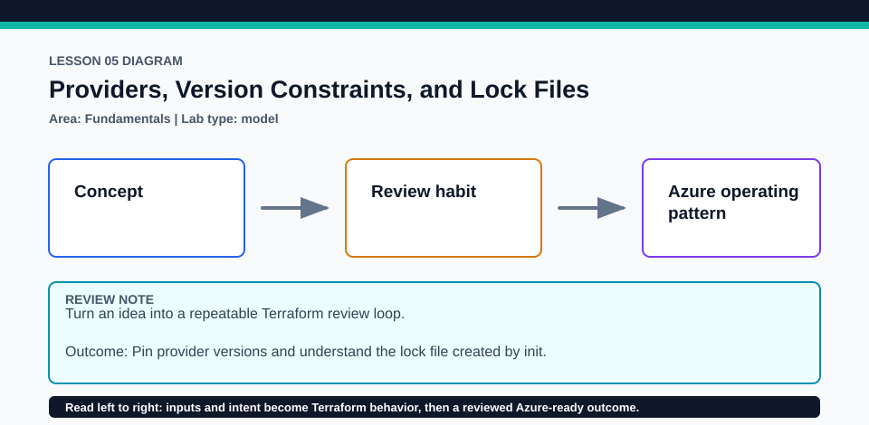

# Lesson 05: Providers, Version Constraints, and Lock Files

Provider upgrades are deliberate repository changes, never routine cleanup.

## Certification alignment

- `2a` — Install and version Terraform providers — **hands-on**: The constrained hashicorp/random provider and random_pet resource create real provider-installation evidence, including lock inspection and an intentional upgrade rehearsal.
- `2b` — Describe how Terraform uses providers — **hands-on**: The constrained hashicorp/random provider and random_pet resource create real provider-installation evidence, including lock inspection and an intentional upgrade rehearsal.
- `3b` — Initialize a Terraform working directory — **hands-on**: The constrained hashicorp/random provider and random_pet resource create real provider-installation evidence, including lock inspection and an intentional upgrade rehearsal.
- `3g` — Apply formatting and style adjustments to a configuration — **hands-on**: The constrained hashicorp/random provider and random_pet resource create real provider-installation evidence, including lock inspection and an intentional upgrade rehearsal.

## Scenario

The team wants repeatable provider installation across laptops and CI.

## Walkthrough

1. Inspect required_providers and identify source, version constraint, and the committed root lock selection.
2. Run initialization in read-only lock mode and use terraform providers to confirm the dependency graph.
3. Apply only if you want to observe random_pet.provider_install; no cloud account is required.
4. Copy the lab to a disposable directory, run terraform init -upgrade there, and compare its lock diff with the committed file before discarding it.

Baseline commands for this lesson:

```powershell
Set-Location lab
terraform init -lockfile=readonly
terraform fmt -check
terraform validate
terraform plan
```

## Expected results

- Initialization verifies the committed checksums for the current platform.
- The plan contains random_pet.provider_install and its output; an apply records the generated pet name in local state.
- An upgrade changes the disposable lock only when a newer release satisfies the constraint.

## Failure modes

- Deleting the lock can silently change provider selection on the next init.
- A constraint that excludes the locked release makes read-only initialization fail until an intentional update.
- Running init -upgrade in the tracked lesson can create an unreviewed lock diff.

## Wiki




## Cleanup

- Destroy the local random_pet instance if it was applied.
- Delete the disposable upgrade directory; do not copy its lock back unless intentionally adopting and testing that upgrade.
- Remove generated `.terraform/`, plan files, state files, debug logs, copied `terraform.tfvars`, and generated secrets only after any required destroy or migration is complete.
- If this root has a committed `.terraform.lock.hcl`, keep it. Never delete a root lock file as routine cleanup; update it only during an intentional, reviewed dependency upgrade.
- Do not commit credentials, real secret values, state, plan files, backend credentials, or local variable files.

## Check questions

1. What different promises are made by a version constraint and a dependency lock?
2. Why rehearse init -upgrade in a disposable copy?
3. Which lock-file changes require reviewer attention?

