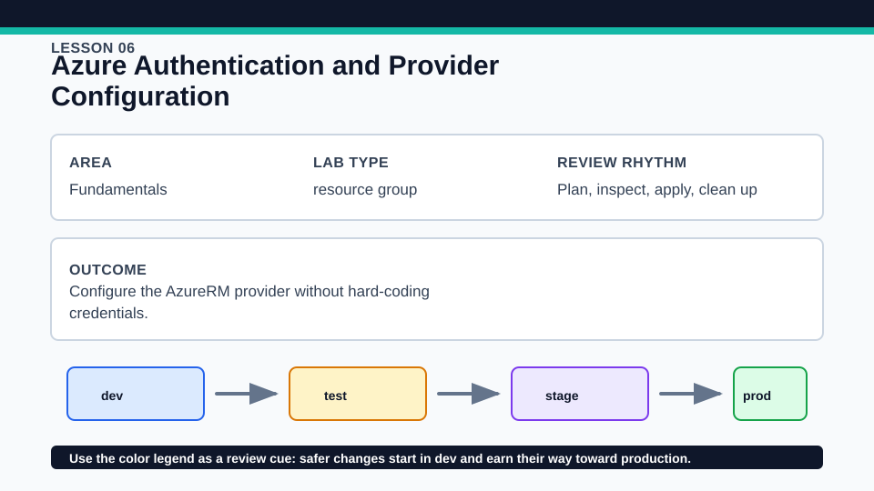
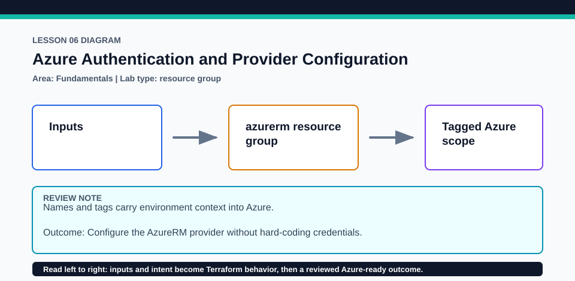

# Lesson 06: Azure Authentication and Provider Configuration

Use least-privilege identities; never paste Azure credentials into Terraform configuration.

## Certification alignment

- `2b` — Describe how Terraform uses providers — **hands-on**: The azurerm provider configuration uses external Azure authentication and a subscription input without embedding credentials in HCL.

## Scenario

A delivery team will run Terraform from both a developer laptop and an automation agent.

## Walkthrough

1. Inspect providers.tf and identify which values select behavior versus which credentials come from the Azure CLI or automation environment.
2. Use az account show to verify tenant and subscription, then set the subscription input without adding a secret.
3. Run the baseline checks and explain how the same provider block can use workload identity or service-principal environment variables in CI.
4. Review the resource-group plan for the correct subscription boundary and provider address.

Baseline commands for this lesson:

```powershell
az account show
Set-Location lab
Copy-Item terraform.tfvars.example terraform.tfvars
terraform init -lockfile=readonly
terraform fmt -check
terraform validate
terraform plan -out=tfplan
```

The plan is credentialed but non-mutating. Apply only in a disposable subscription after confirming the active tenant, subscription, names, region, cost, and every proposed replacement or deletion.

## Expected results

- No client secret appears in configuration, tfvars, plan command, or source control.
- The provider can plan a resource group after Azure CLI authentication and authorization succeed.
- The selected provider version comes from the root lock file, not the login method.

## Failure modes

- A valid login with the wrong active subscription can target the wrong environment.
- Insufficient role assignments cause authorization failures even when authentication succeeds.
- Hard-coded credentials persist in history and violate the lesson's security boundary.

## Wiki




## Cleanup

- If applied, destroy the resource group with the same provider identity and verify removal.
- Clear temporary ARM environment variables and delete the copied terraform.tfvars.
- Remove generated `.terraform/`, plan files, state files, debug logs, copied `terraform.tfvars`, and generated secrets only after any required destroy or migration is complete.
- If this root has a committed `.terraform.lock.hcl`, keep it. Never delete a root lock file as routine cleanup; update it only during an intentional, reviewed dependency upgrade.
- Do not commit credentials, real secret values, state, plan files, backend credentials, or local variable files.

## Check questions

1. What is the difference between authentication and authorization?
2. Which provider settings belong in configuration, and which secrets do not?
3. How would CI authentication change without changing the resource schema?

