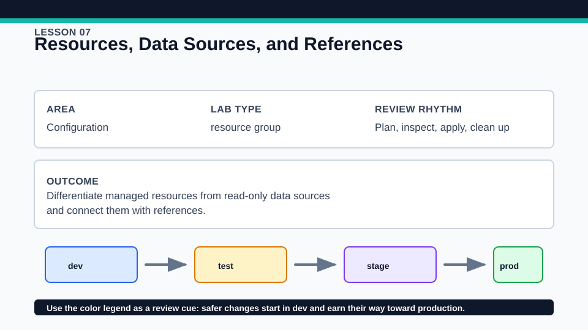
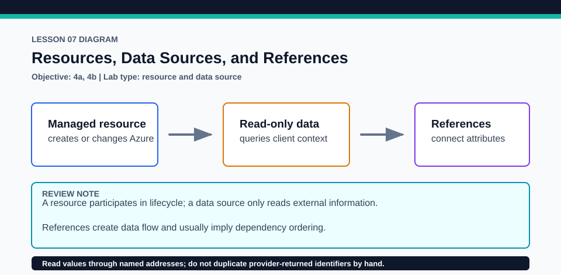

# Lesson 07: Resources, Data Sources, and References

The Azure client data source makes objective 4a executable instead of a keyword-only mapping.

## Certification alignment

- `4a` — Use and differentiate `resource` and `data` blocks — **hands-on**: The active data.azurerm_client_config.current query supplies tenant and subscription attributes to the managed resource group, proving resource/data differences and cross-block references.
- `4b` — Refer to resource attributes and create cross-resource references — **hands-on**: The active data.azurerm_client_config.current query supplies tenant and subscription attributes to the managed resource group, proving resource/data differences and cross-block references.

## Scenario

A reporting dashboard needs to place resources in an existing Azure context and expose useful IDs.

## Walkthrough

1. Locate the data block and list the attributes it reads from the authenticated Azure client.
2. Trace each reference from data.azurerm_client_config.current into resource-group tags and outputs.
3. Run the mocked test if available, then run the credentialed baseline plan and inspect known versus unknown values.
4. Explain which graph edges arise from references and which object Terraform will actually manage.

Baseline commands for this lesson:

```powershell
az account show
Set-Location lab
Copy-Item terraform.tfvars.example terraform.tfvars
terraform init -lockfile=readonly
terraform fmt -check
terraform validate
terraform plan -out=tfplan
```

The plan is credentialed but non-mutating. Apply only in a disposable subscription after confirming the active tenant, subscription, names, region, cost, and every proposed replacement or deletion.

## Expected results

- The plan reads current client context and proposes managing one resource group.
- Tenant and subscription values flow into tags or outputs without a hard-coded duplicate.
- The mock test verifies data-source results reach the managed resource configuration.

## Failure modes

- Planning without Azure authentication prevents the real data source from being read.
- Replacing a reference with copied text removes the automatic data flow and can become stale.
- Treating a data source as managed infrastructure leads to incorrect lifecycle expectations.

## Wiki




## Cleanup

- If applied, destroy the managed resource group; the current-client data source itself has nothing to destroy.
- Remove copied inputs and generated state only after destroy; keep the provider lock.
- Remove generated `.terraform/`, plan files, state files, debug logs, copied `terraform.tfvars`, and generated secrets only after any required destroy or migration is complete.
- If this root has a committed `.terraform.lock.hcl`, keep it. Never delete a root lock file as routine cleanup; update it only during an intentional, reviewed dependency upgrade.
- Do not commit credentials, real secret values, state, plan files, backend credentials, or local variable files.

## Check questions

1. Which block owns lifecycle for the resource group?
2. How does the data-source reference affect the dependency graph?
3. What evidence shows a data source was read rather than created?

