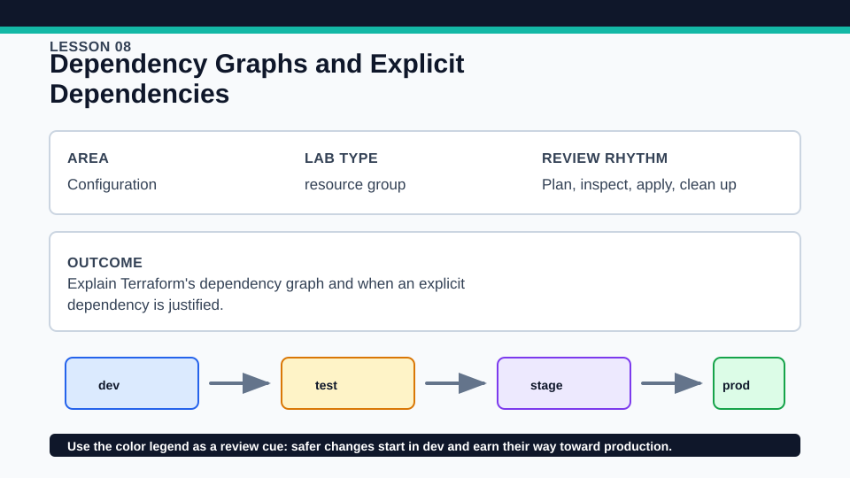
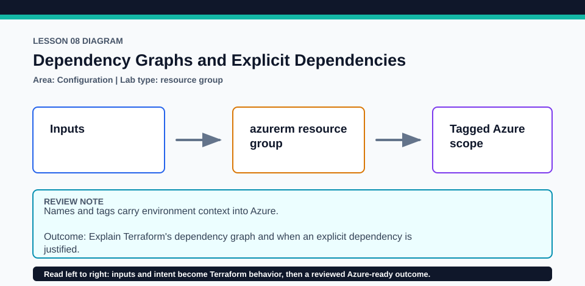

# Lesson 08: Dependency Graphs and Explicit Dependencies

Prefer references for visible data flow and reserve explicit dependencies for real hidden relationships.

## Certification alignment

- `3d` — Generate and review an execution plan for Terraform — **hands-on**: The terraform_data rollout marker combines a normal resource reference with an explicit depends_on so the graph and plan can be inspected.
- `4b` — Refer to resource attributes and create cross-resource references — **hands-on**: The terraform_data rollout marker combines a normal resource reference with an explicit depends_on so the graph and plan can be inspected.
- `4f` — Define resource dependencies in configuration — **hands-on**: The terraform_data rollout marker combines a normal resource reference with an explicit depends_on so the graph and plan can be inspected.

## Scenario

A rollout marker must wait for a resource group before publishing deployment notes.

## Walkthrough

1. Trace the implicit dependency created by values read from azurerm_resource_group.main.
2. Inspect the explicit depends_on on the rollout marker and state the hidden behavior it represents.
3. Run terraform graph or inspect the plan ordering, then decide whether the explicit edge is justified.
4. Compare the broadness of depends_on with a direct attribute reference.

Baseline commands for this lesson:

```powershell
az account show
Set-Location lab
Copy-Item terraform.tfvars.example terraform.tfvars
terraform init -lockfile=readonly
terraform fmt -check
terraform validate
terraform plan -out=tfplan
```

The plan is credentialed but non-mutating. Apply only in a disposable subscription after confirming the active tenant, subscription, names, region, cost, and every proposed replacement or deletion.

## Expected results

- The graph orders the resource group before the rollout marker.
- The plan makes both managed addresses visible and exposes the marker output.
- Removing a justified hidden dependency in a disposable copy changes the graph even if values remain equal.

## Failure modes

- Using depends_on everywhere makes plans conservative and hides actual data flow.
- Assuming list order controls resource creation produces unreliable reasoning.
- A provider-side eventual-consistency issue may still need design beyond an arbitrary dependency edge.

## Wiki




## Cleanup

- If applied, destroy from this root so both the marker and resource group leave state cleanly.
- Remove any generated graph or plan files after review.
- Remove generated `.terraform/`, plan files, state files, debug logs, copied `terraform.tfvars`, and generated secrets only after any required destroy or migration is complete.
- If this root has a committed `.terraform.lock.hcl`, keep it. Never delete a root lock file as routine cleanup; update it only during an intentional, reviewed dependency upgrade.
- Do not commit credentials, real secret values, state, plan files, backend credentials, or local variable files.

## Check questions

1. Which dependency is implicit, and which is explicit?
2. When is depends_on justified despite no attribute reference?
3. Why can a module-wide dependency produce more unknown values?

