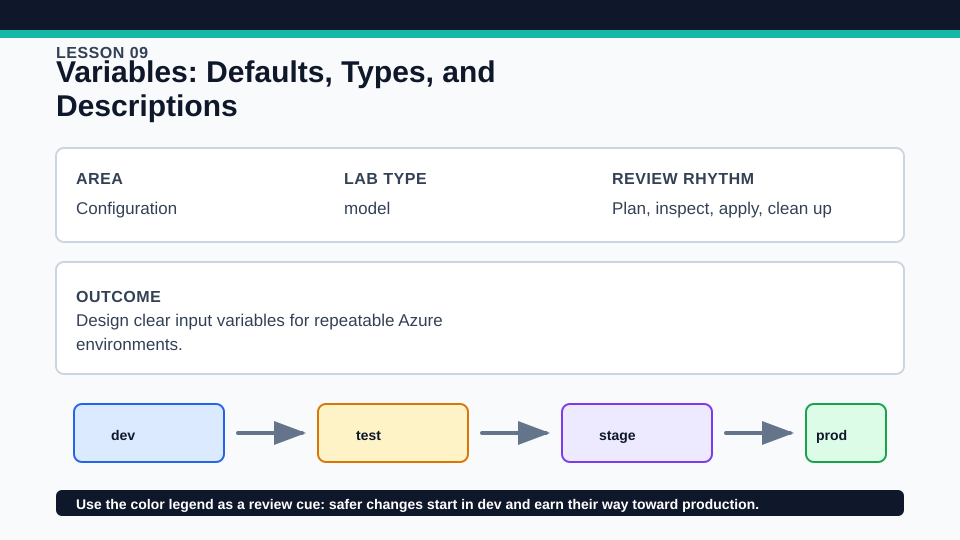
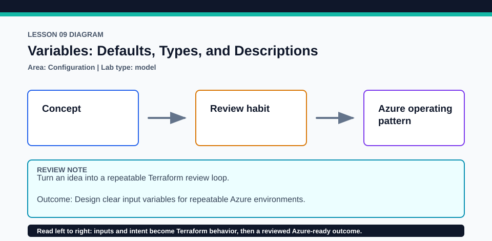

# Lesson 09: Variables: Defaults, Types, and Descriptions

Input design is part of Terraform's public interface, even in a root module.

## Certification alignment

- `4c` — Use variables and outputs — **hands-on**: Typed, documented input variables feed a local terraform_data contract and outputs, demonstrating a clear module input boundary.

## Scenario

Several squads will reuse a lab but need different prefixes, regions, and workload labels.

## Walkthrough

1. Inspect each variable's type, description, default, and validation, if present.
2. Create a disposable auto.tfvars file with non-secret overrides and run plan.
3. Pass one alternative value on the command line and compare the resulting output.
4. Classify which values should remain required, which deserve safe defaults, and which should not be inputs.

Baseline commands for this lesson:

```powershell
Set-Location lab
terraform init -lockfile=readonly
terraform fmt -check
terraform validate
terraform plan
```

## Expected results

- The plan shows the local contract changing when an input changes.
- Type-incompatible values fail before any apply.
- Outputs expose the computed summary without requiring a cloud provider.

## Failure modes

- Using type any hides interface mistakes until later expression evaluation.
- A default can accidentally encode an unsafe production assumption.
- Putting credentials in a tfvars example encourages secret persistence.

## Wiki




## Cleanup

- If applied, destroy the local terraform_data contract.
- Delete disposable variable files and shell history entries containing test values; preserve tracked examples and locks.
- Remove generated `.terraform/`, plan files, state files, debug logs, copied `terraform.tfvars`, and generated secrets only after any required destroy or migration is complete.
- If this root has a committed `.terraform.lock.hcl`, keep it. Never delete a root lock file as routine cleanup; update it only during an intentional, reviewed dependency upgrade.
- Do not commit credentials, real secret values, state, plan files, backend credentials, or local variable files.

## Check questions

1. What makes a variable interface self-documenting?
2. When is omitting a default preferable?
3. Which input in this lab would benefit from additional validation?

