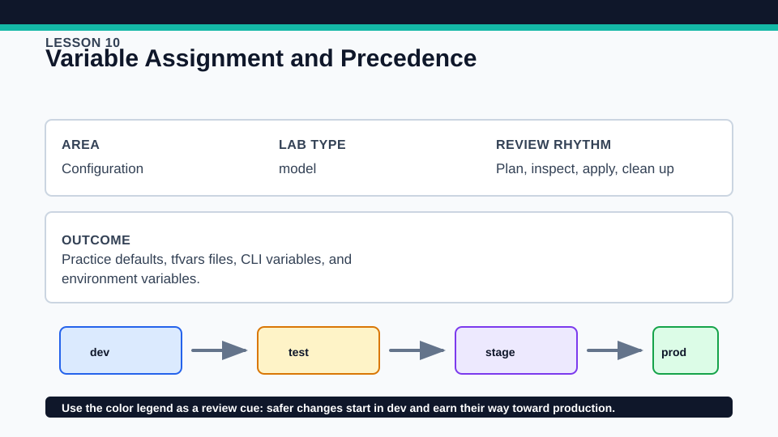
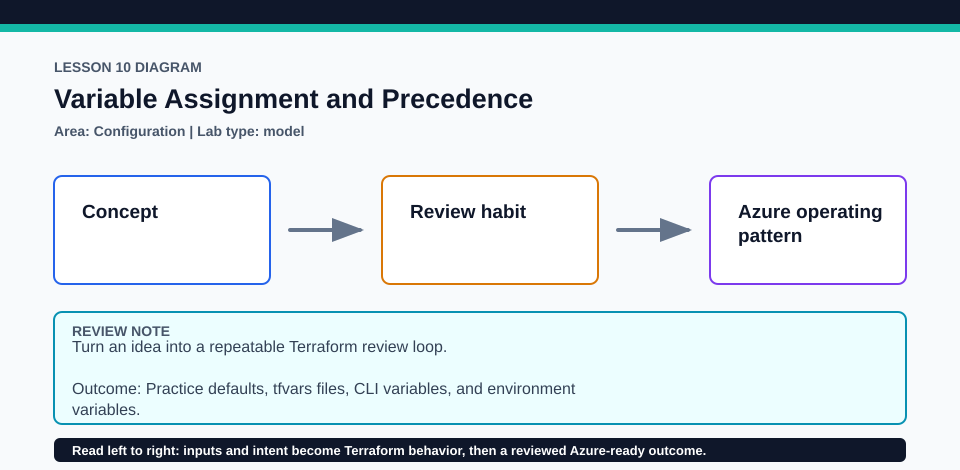

# Lesson 10: Variable Assignment and Precedence

Use throwaway values only; command history is not an appropriate place for secrets.

## Certification alignment

- `4c` — Use variables and outputs — **hands-on**: Repeated plans demonstrate variable assignment precedence across defaults, automatically loaded files, environment variables, and explicit CLI arguments.

## Scenario

The same service-status lab moves through dev, test, and production naming.

## Walkthrough

1. Record the default output from an initial plan.
2. In a disposable copy, set the same variable through terraform.tfvars, an auto.tfvars file, TF_VAR environment data, and finally a -var argument.
3. Run one plan after each change and record which value wins.
4. Remove the highest-precedence source after each run so the next source becomes observable.

Baseline commands for this lesson:

```powershell
Set-Location lab
terraform init -lockfile=readonly
terraform fmt -check
terraform validate
terraform plan
```

## Expected results

- Each plan exposes the value selected by the documented precedence rules.
- An explicit -var value overrides the competing lower-precedence values in the exercise.
- Removing all overrides returns the output to its default.

## Failure modes

- Leaving TF_VAR values in the shell makes later plans appear inexplicably different.
- Multiple auto.tfvars files with competing values depend on lexical loading order.
- Assuming terraform.tfvars is always the highest-precedence source leads to wrong predictions.

## Wiki




## Cleanup

- If applied, destroy the local contract before removing state.
- Clear every TF_VAR value set for the exercise and delete disposable tfvars files; keep terraform.tfvars.example.
- Remove generated `.terraform/`, plan files, state files, debug logs, copied `terraform.tfvars`, and generated secrets only after any required destroy or migration is complete.
- If this root has a committed `.terraform.lock.hcl`, keep it. Never delete a root lock file as routine cleanup; update it only during an intentional, reviewed dependency upgrade.
- Do not commit credentials, real secret values, state, plan files, backend credentials, or local variable files.

## Check questions

1. Which source won in the final comparison, and why?
2. How can CI make variable sources explicit and auditable?
3. Why is a stale environment variable difficult to diagnose?

