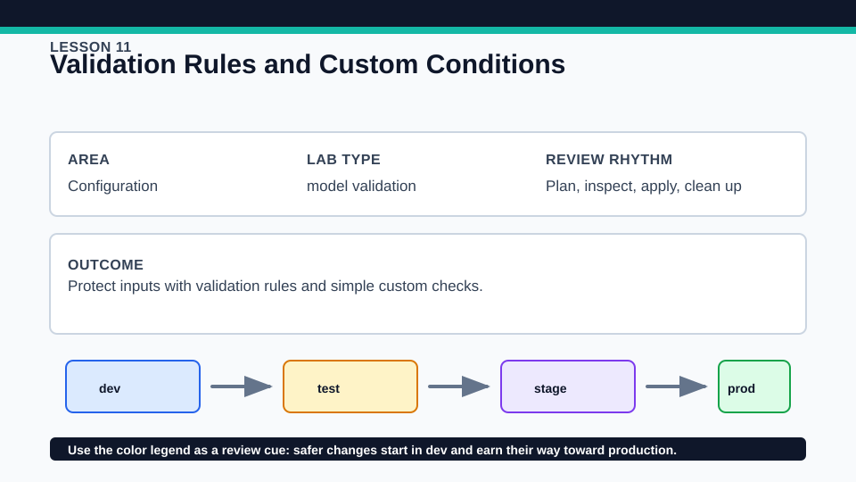
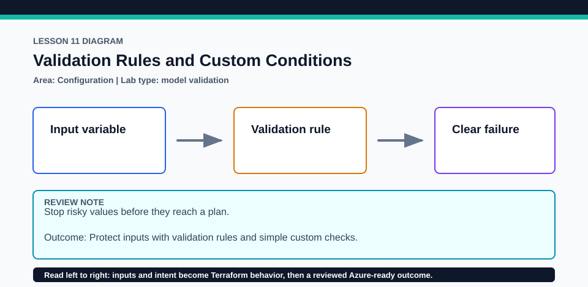

# Lesson 11: Validation Rules and Custom Conditions

Custom conditions are guardrails with distinct scopes, not interchangeable syntax decorations.

## Certification alignment

- `3c` — Validate a Terraform configuration — **hands-on**: The local exercise triggers variable validation, lifecycle preconditions and postconditions, and check assertions at their appropriate evaluation boundaries.
- `4g` — Validate configuration using custom conditions — **hands-on**: The local exercise triggers variable validation, lifecycle preconditions and postconditions, and check assertions at their appropriate evaluation boundaries.

## Scenario

An internal dashboard must reject unsupported regions and unsafe environment names.

## Walkthrough

1. Locate every condition and name the boundary at which Terraform evaluates it.
2. Run a valid plan, then pass one invalid value at a time in a disposable copy and capture the error message.
3. Compare a variable validation rule with a resource precondition and a postcondition.
4. Run the mocked or local tests and match each failing case to its intended condition.

Baseline commands for this lesson:

```powershell
Set-Location lab
terraform init -lockfile=readonly
terraform fmt -check
terraform validate
terraform plan
```

## Expected results

- Valid inputs produce a plan for the local contract and all assertions pass.
- Invalid environment or location input fails with the authored message before an unsafe apply.
- A deliberately broken result demonstrates a postcondition or check without confusing it with input validation.

## Failure modes

- A condition that references values unavailable at its evaluation boundary can remain unknown or fail unexpectedly.
- Vague error_message text tells the learner what failed but not how to correct it.
- Using a check when the operation must be blocked can provide weaker enforcement than a precondition.

## Wiki




## Cleanup

- Destroy any local contract applied during the valid case.
- Remove disposable failing-case files and test artifacts; do not weaken tracked conditions merely to make a bad value pass.
- Remove generated `.terraform/`, plan files, state files, debug logs, copied `terraform.tfvars`, and generated secrets only after any required destroy or migration is complete.
- If this root has a committed `.terraform.lock.hcl`, keep it. Never delete a root lock file as routine cleanup; update it only during an intentional, reviewed dependency upgrade.
- Do not commit credentials, real secret values, state, plan files, backend credentials, or local variable files.

## Check questions

1. Which condition rejects input earliest?
2. When is a postcondition more appropriate than variable validation?
3. How does a check block differ from a managed resource?

