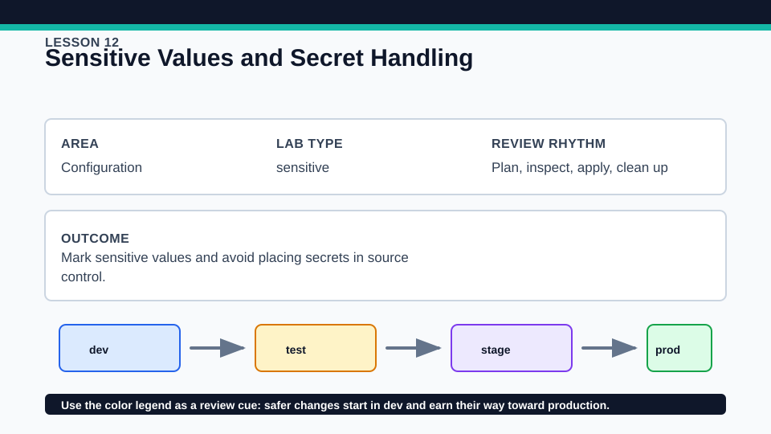
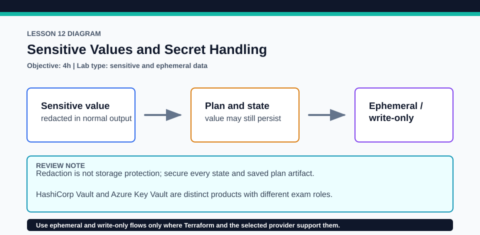

# Lesson 12: Sensitive Values and Secret Handling

Only synthetic throwaway values belong in this lab; state and logs remain sensitive even during training.

## Certification alignment

- `4h` — Understand best practices for managing sensitive data, including secrets management with Vault — **hands-on**: The lab contrasts a sensitive state-backed terraform_data value with an ephemeral random_password, then guides a product-accurate HashiCorp Vault versus Azure Key Vault comparison.
- Additional 004 topic `004-ephemeral-values` — hands-on comparison of state-backed and ephemeral values.
- Additional 004 topic `004-write-only-arguments` — guided review of provider-supported write-only arguments.

## Scenario

A secure application workflow needs transient credentials without pretending that output redaction removes all state risk.

## Walkthrough

1. Use only the throwaway example value and apply the state-backed example in a disposable state.
2. Observe that the sensitive output is redacted, then inspect state securely to confirm the normal value can still persist.
3. Run the ephemeral random_password path and verify the transient value is omitted from plan and state persistence.
4. Review hashicorp-vault.tf.example and azure-key-vault.tf.example; identify which product each provider/data source addresses and where ephemeral or write-only support must be explicit.

Baseline commands for this lesson:

```powershell
Set-Location lab
terraform init -lockfile=readonly
terraform fmt -check
terraform validate
terraform plan
```

## Expected results

- Routine CLI output redacts the sensitive state-backed value while state inspection proves redaction is not deletion.
- The ephemeral password can flow only through supported ephemeral contexts and is absent from persisted plan/state data.
- The two example files clearly distinguish HashiCorp Vault from Microsoft's Azure Key Vault.

## Failure modes

- Using a real secret would place unnecessary sensitive material in a training state or log.
- Passing an ephemeral value into a non-ephemeral argument fails because Terraform must preserve the persistence boundary.
- Assuming every provider argument is write-only ignores provider schema support.

## Wiki




## Cleanup

- Destroy the throwaway state-backed resource before deleting its disposable state.
- Delete any saved plan, state copy, shell history, or debug output that could contain the exercise value.
- Do not enable or apply either secret-manager example with production credentials in this course lab.
- Remove generated `.terraform/`, plan files, state files, debug logs, copied `terraform.tfvars`, and generated secrets only after any required destroy or migration is complete.
- If this root has a committed `.terraform.lock.hcl`, keep it. Never delete a root lock file as routine cleanup; update it only during an intentional, reviewed dependency upgrade.
- Do not commit credentials, real secret values, state, plan files, backend credentials, or local variable files.

## Check questions

1. What does sensitive marking hide, and what can it still retain?
2. How does an ephemeral value change persistence expectations?
3. Why must the exam objective's Vault wording not be replaced with Azure Key Vault?

