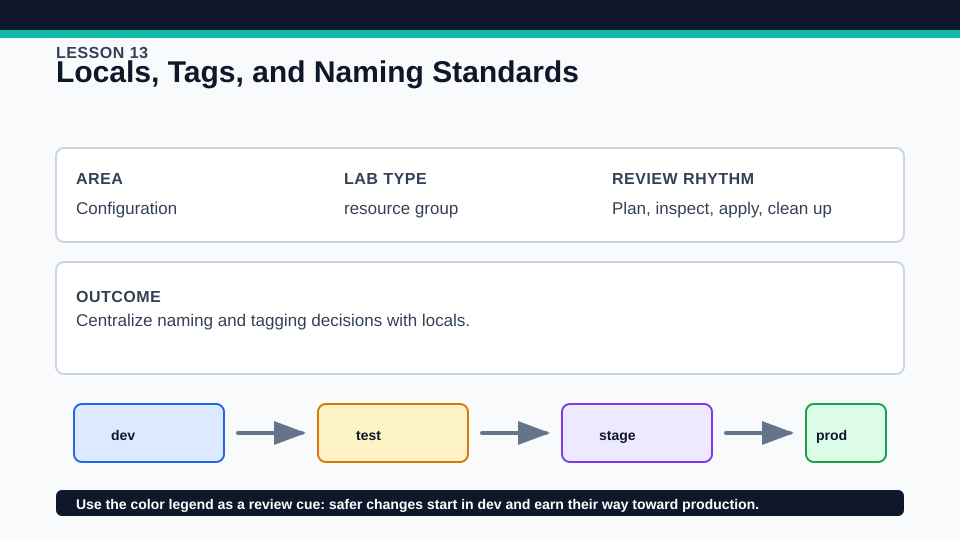
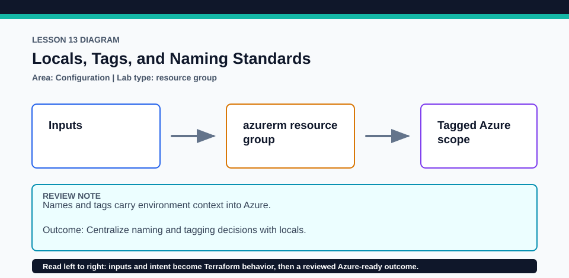

# Lesson 13: Locals, Tags, and Naming Standards

Locals improve internal readability but are not inputs visible to module callers.

## Certification alignment

- `4e` — Write dynamic configuration using expressions and functions — **hands-on**: Locals combine input variables, naming expressions, and a canonical tag map before those values reach the managed resource group.

## Scenario

A cost review team asks every Azure resource to carry consistent ownership tags.

## Walkthrough

1. Trace each input into the locals that normalize the resource name and common tags.
2. Change one ownership value in a disposable tfvars file and review the exact tag diff.
3. Identify which expressions are pure transformations and which values come from a provider-managed resource.
4. Plan the resource group and verify every required tag is present.

Baseline commands for this lesson:

```powershell
az account show
Set-Location lab
Copy-Item terraform.tfvars.example terraform.tfvars
terraform init -lockfile=readonly
terraform fmt -check
terraform validate
terraform plan -out=tfplan
```

The plan is credentialed but non-mutating. Apply only in a disposable subscription after confirming the active tenant, subscription, names, region, cost, and every proposed replacement or deletion.

## Expected results

- The computed name is consistent with the declared environment and workload.
- The plan shows a single reusable tag map rather than repeated literal values.
- Changing a local input produces a focused, reviewable diff.

## Failure modes

- Duplicating tags in every resource invites inconsistent spelling and ownership data.
- Putting a changing property into a resource name can force unnecessary replacement.
- An Azure Policy may add or reject tags, causing drift or apply failure that the plan must reveal.

## Wiki




## Cleanup

- If applied, destroy the resource group and verify it is gone.
- Delete the copied variable file only after destroy; preserve the root lock.
- Remove generated `.terraform/`, plan files, state files, debug logs, copied `terraform.tfvars`, and generated secrets only after any required destroy or migration is complete.
- If this root has a committed `.terraform.lock.hcl`, keep it. Never delete a root lock file as routine cleanup; update it only during an intentional, reviewed dependency upgrade.
- Do not commit credentials, real secret values, state, plan files, backend credentials, or local variable files.

## Check questions

1. Which values deserve a local rather than a new input variable?
2. How does centralizing tags improve review?
3. Which naming change could force replacement?

