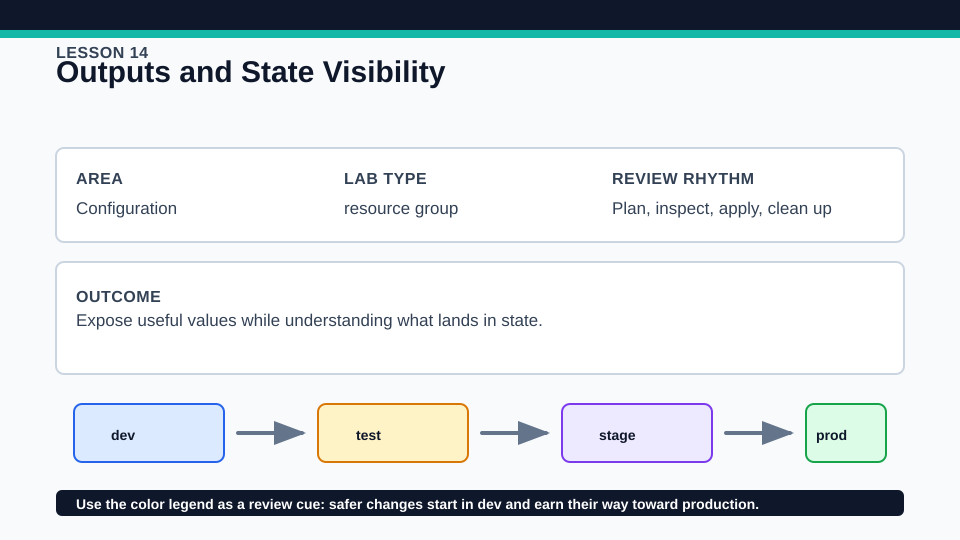
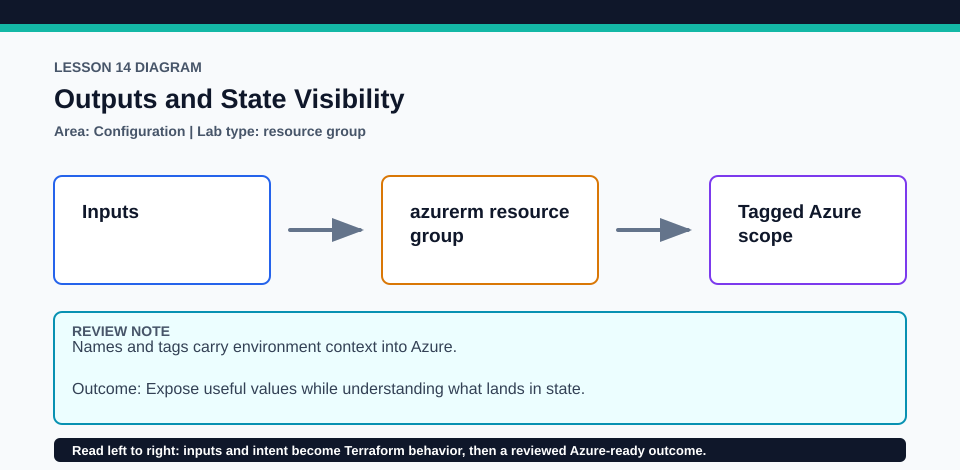

# Lesson 14: Outputs and State Visibility

Outputs are an explicit interface, not a substitute for securing backend state.

## Certification alignment

- `2d` — Explain how Terraform uses and manages state — **guided**: Outputs publish selected resource attributes while the guided state inspection shows that output sensitivity and state visibility are separate concerns.
- `4c` — Use variables and outputs — **hands-on**: Outputs publish selected resource attributes while the guided state inspection shows that output sensitivity and state visibility are separate concerns.

## Scenario

An operations handoff needs resource names, locations, and support metadata after apply.

## Walkthrough

1. Review every output description and trace it to a variable, local, or resource attribute.
2. Plan and identify which output values are known before apply and which remain unknown until provider response.
3. If applied, run terraform output and terraform output -json, then inspect state only in the secured local lab.
4. Classify each candidate value as useful interface data, noisy implementation detail, or sensitive data.

Baseline commands for this lesson:

```powershell
az account show
Set-Location lab
Copy-Item terraform.tfvars.example terraform.tfvars
terraform init -lockfile=readonly
terraform fmt -check
terraform validate
terraform plan -out=tfplan
```

The plan is credentialed but non-mutating. Apply only in a disposable subscription after confirming the active tenant, subscription, names, region, cost, and every proposed replacement or deletion.

## Expected results

- The plan or apply exposes named outputs with clear descriptions.
- Provider-generated IDs become known after apply and are stored with the resource state.
- JSON output is machine-readable but still requires sensitive-data handling.

## Failure modes

- Publishing every resource attribute creates a brittle and overly broad interface.
- Marking an output sensitive only redacts normal display; its backing value can remain in state.
- Sharing terraform output -json without review can disclose values hidden in the human display.

## Wiki




## Cleanup

- If applied, destroy the Azure resource group before deleting local state.
- Do not paste state or JSON output into tickets; delete disposable exports after review.
- Remove generated `.terraform/`, plan files, state files, debug logs, copied `terraform.tfvars`, and generated secrets only after any required destroy or migration is complete.
- If this root has a committed `.terraform.lock.hcl`, keep it. Never delete a root lock file as routine cleanup; update it only during an intentional, reviewed dependency upgrade.
- Do not commit credentials, real secret values, state, plan files, backend credentials, or local variable files.

## Check questions

1. Which output is a stable interface versus an implementation detail?
2. Why can an output be unknown during plan?
3. What security control is still needed for a sensitive output?

