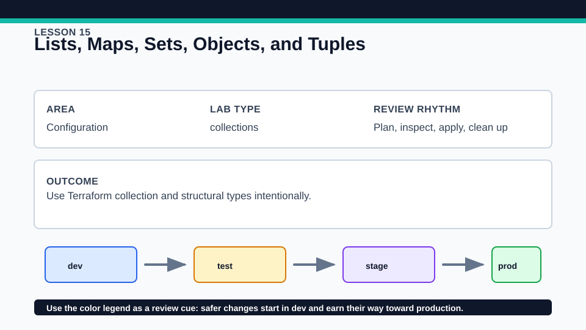
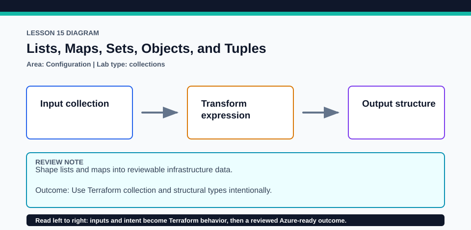

# Lesson 15: Lists, Maps, Sets, Objects, and Tuples

Choose a type for its identity and validation semantics, not just because a sample value happens to fit.

## Certification alignment

- `4d` — Understand and use complex types — **hands-on**: Typed locals and variables exercise list, map, set, object, and tuple behavior without requiring a provider account.

## Scenario

A monitoring workspace accepts teams, alert severities, network names, and service metadata.

## Walkthrough

1. Locate one example of each complex type and predict its value shape.
2. Use terraform console to inspect indexing, key lookup, set conversion, and object attributes.
3. Pass a value with the wrong element or attribute type and read the diagnostic.
4. Decide which collection needs stable keys, uniqueness, order, or fixed heterogeneous positions.

Baseline commands for this lesson:

```powershell
Set-Location lab
terraform init -lockfile=readonly
terraform fmt -check
terraform validate
terraform plan
```

## Expected results

- Valid values preserve each declared shape through the local plan and outputs.
- A set removes duplicate elements and does not provide index identity.
- A malformed object or tuple fails type conversion with a path to the incompatible value.

## Failure modes

- Using a list when stable keyed identity is required can lead to index-shift churn.
- Converting a set to a list and relying on incidental order creates fragile results.
- Broad any constraints postpone useful type errors.

## Wiki




## Cleanup

- Destroy the local contract if applied and exit terraform console.
- Remove only disposable input files and state after destroy; keep tracked examples and locks.
- Remove generated `.terraform/`, plan files, state files, debug logs, copied `terraform.tfvars`, and generated secrets only after any required destroy or migration is complete.
- If this root has a committed `.terraform.lock.hcl`, keep it. Never delete a root lock file as routine cleanup; update it only during an intentional, reviewed dependency upgrade.
- Do not commit credentials, real secret values, state, plan files, backend credentials, or local variable files.

## Check questions

1. When should a map be preferred over a list?
2. Why does a set not support stable numeric indexing?
3. What makes an object different from a tuple?

