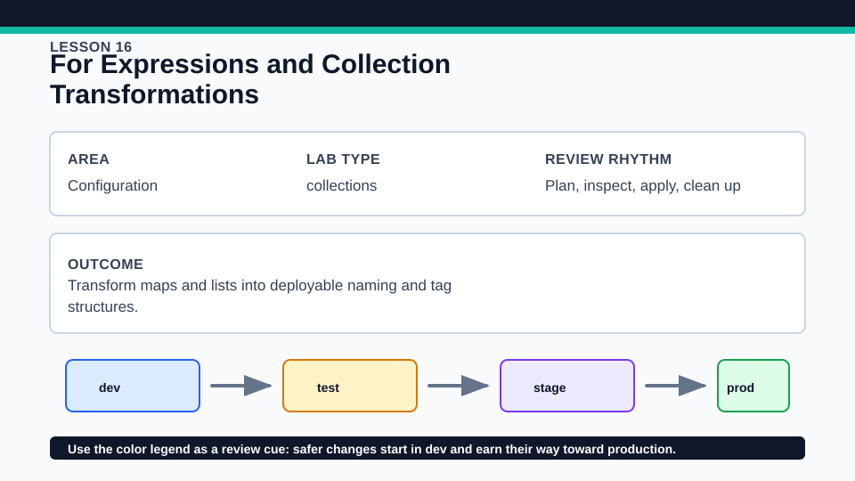
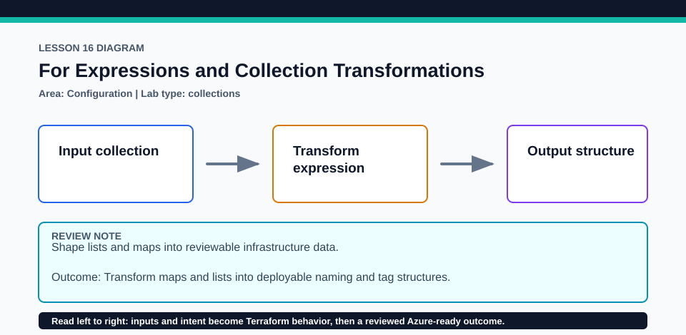

# Lesson 16: For Expressions and Collection Transformations

Expressions transform values; they do not create nested resource blocks by themselves.

## Certification alignment

- `4d` — Understand and use complex types — **hands-on**: For expressions transform maps and lists into normalized names, filtered subsets, and grouped output values.
- `4e` — Write dynamic configuration using expressions and functions — **hands-on**: For expressions transform maps and lists into normalized names, filtered subsets, and grouped output values.

## Scenario

A portfolio dashboard needs stable labels generated from team ownership data.

## Walkthrough

1. Read each for expression and state its input collection, output type, and optional filter.
2. Use terraform console to evaluate the expressions with one added and one removed element.
3. Change capitalization or spacing and observe the normalization functions inside the transformation.
4. Compare a transformed map with a transformed list and explain how keys affect downstream identity.

Baseline commands for this lesson:

```powershell
Set-Location lab
terraform init -lockfile=readonly
terraform fmt -check
terraform validate
terraform plan
```

## Expected results

- Outputs show predictable normalized collections derived from the inputs.
- A filtered expression includes only elements whose condition evaluates true.
- Map-producing expressions retain explicit keys suitable for later for_each use.

## Failure modes

- Duplicate generated keys can make a map expression fail unless grouping is intentional.
- A filter placed after the result expression still evaluates according to Terraform's for syntax, not shell syntax.
- Transforming to a list too early can discard stable keys needed downstream.

## Wiki




## Cleanup

- Destroy the local terraform_data instance if applied.
- Remove console transcripts or disposable inputs that include organization-specific names.
- Remove generated `.terraform/`, plan files, state files, debug logs, copied `terraform.tfvars`, and generated secrets only after any required destroy or migration is complete.
- If this root has a committed `.terraform.lock.hcl`, keep it. Never delete a root lock file as routine cleanup; update it only during an intentional, reviewed dependency upgrade.
- Do not commit credentials, real secret values, state, plan files, backend credentials, or local variable files.

## Check questions

1. What type does each expression return?
2. Where would an if clause reduce the collection?
3. How can a for expression prepare data for for_each?

