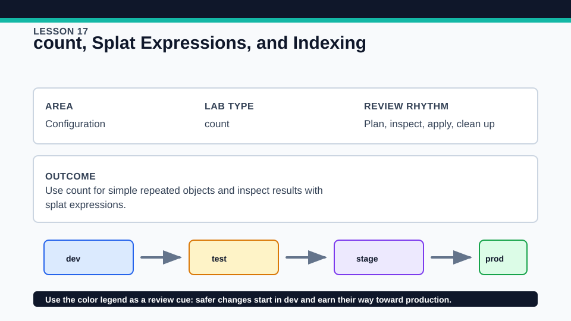
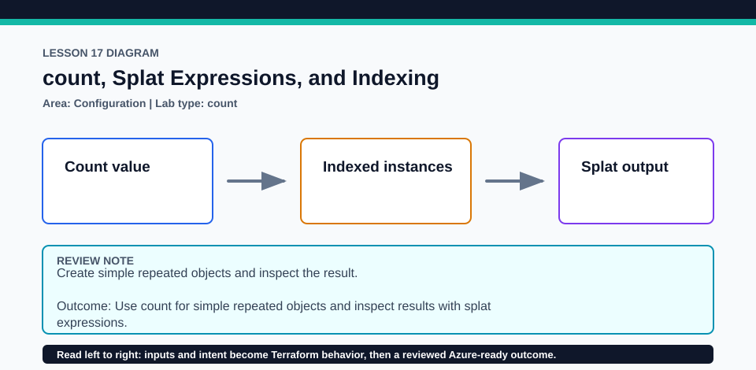

# Lesson 17: count, Splat Expressions, and Indexing

count is best when instances are interchangeable or controlled by a simple numeric condition.

## Certification alignment

- `4e` — Write dynamic configuration using expressions and functions — **hands-on**: count creates indexed local instances and splat expressions collect their attributes for comparison.

## Scenario

A training subscription needs several temporary lab slots created from one template.

## Walkthrough

1. Inspect the count expression and predict every numeric resource address.
2. Plan with three instances, then reduce the count in a disposable override and identify which address disappears.
3. Compare a full splat result with explicit indexing.
4. Explain why index identity is acceptable for identical temporary slots but risky for named environments.

Baseline commands for this lesson:

```powershell
Set-Location lab
terraform init -lockfile=readonly
terraform fmt -check
terraform validate
terraform plan
```

## Expected results

- The plan lists instances with addresses ending in [0], [1], and [2].
- The splat output collects the same attribute from every instance.
- Lowering count removes the highest indexed instances rather than a named key.

## Failure modes

- Removing an item from the middle of an input list can shift several count-based identities.
- Indexing an empty result raises an invalid-index error.
- Using count for durable named objects makes plans harder to reason about.

## Wiki




## Cleanup

- If applied, restore or destroy every local count instance before removing state.
- Delete disposable count overrides and keep the tracked example unchanged.
- Remove generated `.terraform/`, plan files, state files, debug logs, copied `terraform.tfvars`, and generated secrets only after any required destroy or migration is complete.
- If this root has a committed `.terraform.lock.hcl`, keep it. Never delete a root lock file as routine cleanup; update it only during an intentional, reviewed dependency upgrade.
- Do not commit credentials, real secret values, state, plan files, backend credentials, or local variable files.

## Check questions

1. Which address is removed when count changes from three to two?
2. When is a splat clearer than a for expression?
3. Why are stable business keys often safer than indexes?

