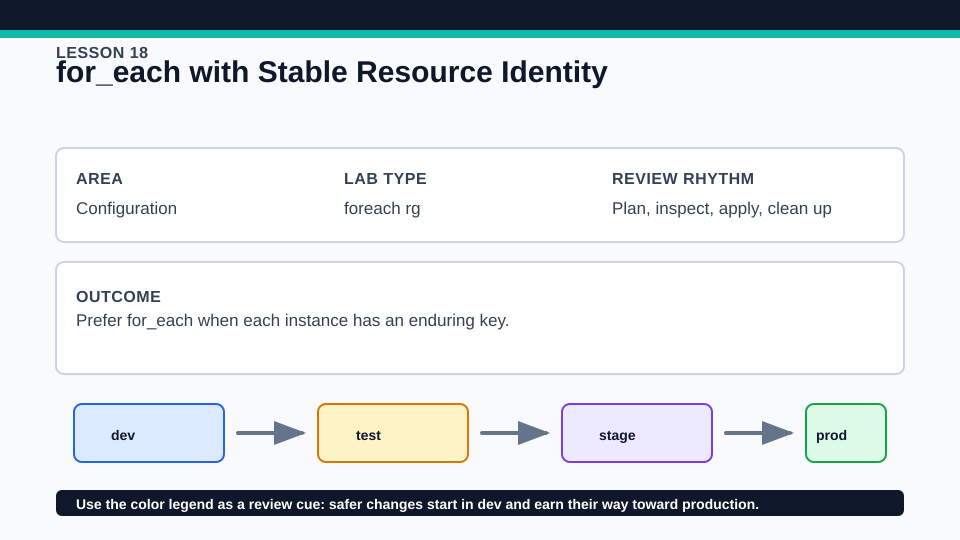
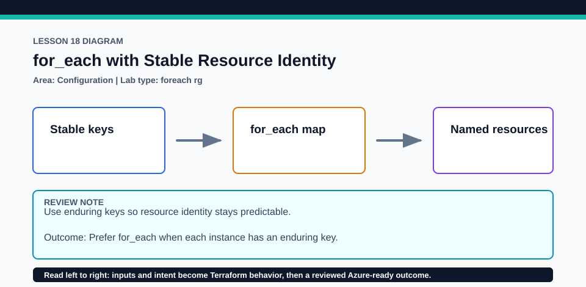

# Lesson 18: for_each with Stable Resource Identity

Stable keys are part of resource identity and should be chosen as carefully as Azure names.

## Certification alignment

- `4d` — Understand and use complex types — **hands-on**: for_each keys Azure resource-group instances by durable region names and exposes keyed outputs.
- `4e` — Write dynamic configuration using expressions and functions — **hands-on**: for_each keys Azure resource-group instances by durable region names and exposes keyed outputs.

## Scenario

Regional landing zones are tracked by name so adding one does not rename the others.

## Walkthrough

1. Inspect the map used by for_each and predict each resource address.
2. Plan the baseline, then add one region key in a disposable override and verify existing addresses stay unchanged.
3. Remove a nonfinal key and compare the focused plan with the index-shift behavior from Lesson 17.
4. Reference one instance by key and inspect the map-shaped output.

Baseline commands for this lesson:

```powershell
az account show
Set-Location lab
Copy-Item terraform.tfvars.example terraform.tfvars
terraform init -lockfile=readonly
terraform fmt -check
terraform validate
terraform plan -out=tfplan
```

The plan is credentialed but non-mutating. Apply only in a disposable subscription after confirming the active tenant, subscription, names, region, cost, and every proposed replacement or deletion.

## Expected results

- Resource addresses contain stable string keys such as the region name.
- Adding one map element proposes one new resource group without renaming existing instances.
- Outputs preserve the key-to-resource relationship.

## Failure modes

- Changing a map key is a remove-and-add identity change, not an in-place rename.
- Converting an unordered set of complex objects for for_each is invalid because keys are unclear.
- Duplicate or policy-invalid Azure names can still make provider operations fail.

## Wiki




## Cleanup

- If applied, destroy all keyed resource groups from the same state and verify each is gone.
- Delete local overrides only after destroy; retain the provider lock.
- Remove generated `.terraform/`, plan files, state files, debug logs, copied `terraform.tfvars`, and generated secrets only after any required destroy or migration is complete.
- If this root has a committed `.terraform.lock.hcl`, keep it. Never delete a root lock file as routine cleanup; update it only during an intentional, reviewed dependency upgrade.
- Do not commit credentials, real secret values, state, plan files, backend credentials, or local variable files.

## Check questions

1. What makes a key durable enough for for_each?
2. Why is renaming a key usually destructive?
3. How does the output type differ from a count splat?

