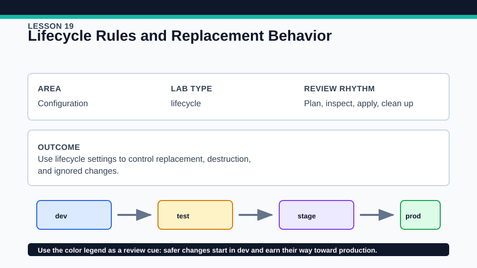
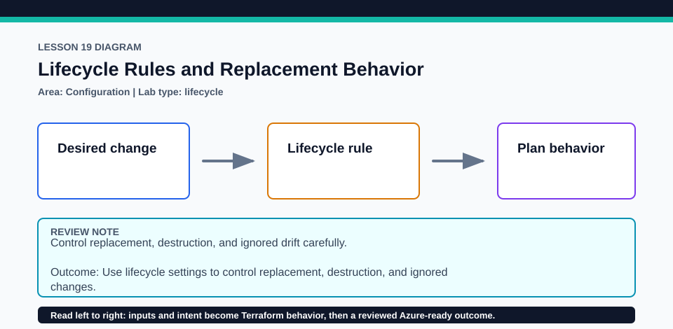

# Lesson 19: Lifecycle Rules and Replacement Behavior

Lifecycle rules refine Terraform behavior but do not override remote platform constraints.

## Certification alignment

- `4f` — Define resource dependencies in configuration — **guided**: The guided lifecycle comparison explores prevent_destroy, ignore_changes, create_before_destroy, and the dependency implications of replacement.
- `6d` — Manage resource drift and Terraform state — **guided**: The guided lifecycle comparison explores prevent_destroy, ignore_changes, create_before_destroy, and the dependency implications of replacement.

## Scenario

A status page must keep a stable resource group while tags may be adjusted outside Terraform.

## Walkthrough

1. Read the lifecycle block and state which proposed actions each setting can affect.
2. Use a disposable copy to change a replacement-sensitive argument and review the plan without applying.
3. Compare provider or platform uniqueness constraints with create_before_destroy ordering.
4. Simulate an out-of-band tag change only in a disposable resource, then decide whether reconciliation or ignore_changes is the better ownership policy.

Baseline commands for this lesson:

```powershell
az account show
Set-Location lab
Copy-Item terraform.tfvars.example terraform.tfvars
terraform init -lockfile=readonly
terraform fmt -check
terraform validate
terraform plan -out=tfplan
```

The plan is credentialed but non-mutating. Apply only in a disposable subscription after confirming the active tenant, subscription, names, region, cost, and every proposed replacement or deletion.

## Expected results

- The plan explains whether a change is in-place or requires replacement.
- A protected destroy or replacement is rejected when prevent_destroy applies.
- Ignored attributes are omitted from corrective plans only for the configured paths.

## Failure modes

- prevent_destroy can block legitimate cleanup if left enabled in a disposable lab.
- create_before_destroy cannot overcome Azure uniqueness rules that forbid two identical names.
- ignore_changes can hide meaningful drift when ownership is not clearly documented.

## Wiki




## Cleanup

- Remove any temporary lifecycle protection deliberately before destroying an applied lab resource.
- Destroy the resource group and verify deletion before removing state.
- Do not leave an Azure object orphaned merely to satisfy prevent_destroy.
- Remove generated `.terraform/`, plan files, state files, debug logs, copied `terraform.tfvars`, and generated secrets only after any required destroy or migration is complete.
- If this root has a committed `.terraform.lock.hcl`, keep it. Never delete a root lock file as routine cleanup; update it only during an intentional, reviewed dependency upgrade.
- Do not commit credentials, real secret values, state, plan files, backend credentials, or local variable files.

## Check questions

1. Which lifecycle rule changes ordering rather than the need for replacement?
2. When does ignore_changes represent shared ownership, and when does it hide drift?
3. Why can prevent_destroy protect state but complicate cleanup?

