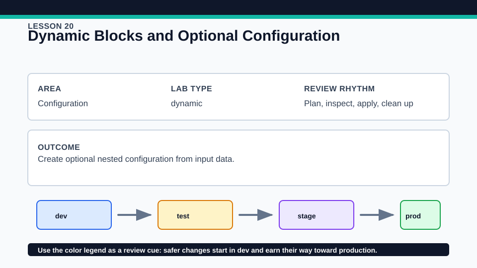
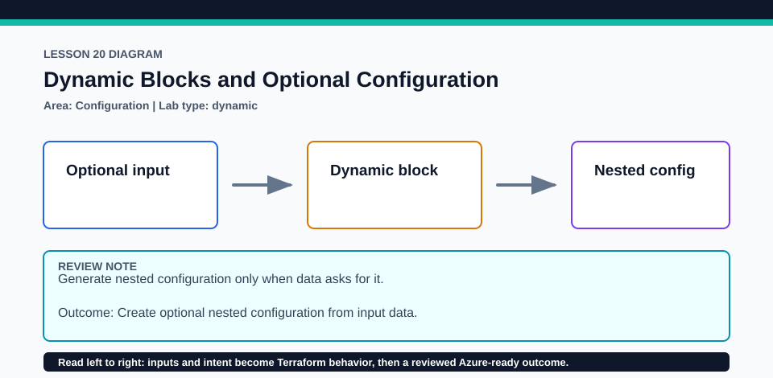

# Lesson 20: Dynamic Blocks and Optional Configuration

This lesson provides the primary hands-on evidence for dynamic configuration in objective 4e.

## Certification alignment

- `4d` — Understand and use complex types — **hands-on**: A typed rule collection drives real dynamic security_rule blocks inside an Azure network security group, with a mocked two-rule test.
- `4e` — Write dynamic configuration using expressions and functions — **hands-on**: A typed rule collection drives real dynamic security_rule blocks inside an Azure network security group, with a mocked two-rule test.

## Scenario

A network review template must generate optional inbound rules only for services that need them.

## Walkthrough

1. Inspect the rule object type and validation before reading the dynamic block.
2. Trace for_each inside dynamic security_rule and map every iterator attribute to an NSG argument.
3. Run the credential-free mocked test, then plan with zero, one, and two rules in disposable inputs.
4. Compare a dynamic nested block with resource-level for_each and a normal for expression.

Baseline commands for this lesson:

```powershell
az account show
Set-Location lab
Copy-Item terraform.tfvars.example terraform.tfvars
terraform init -lockfile=readonly
terraform fmt -check
terraform validate
terraform plan -out=tfplan
```

The plan is credentialed but non-mutating. Apply only in a disposable subscription after confirming the active tenant, subscription, names, region, cost, and every proposed replacement or deletion.

## Expected results

- The mocked test confirms two input objects generate two NSG security_rule blocks.
- The Azure plan proposes a resource group and NSG with only the requested rules.
- An empty rule collection produces no nested rule blocks while the NSG remains valid.

## Failure modes

- Duplicate NSG priorities or invalid port ranges pass HCL parsing but fail validation or provider rules.
- Using a dynamic block for a normal scalar argument is invalid.
- Iterator-name confusion can reference the wrong value in nested expressions.

## Wiki




## Cleanup

- If applied, destroy the NSG and resource group together and verify removal.
- Delete disposable rule inputs and test artifacts; retain tracked tests and provider locks.
- Remove generated `.terraform/`, plan files, state files, debug logs, copied `terraform.tfvars`, and generated secrets only after any required destroy or migration is complete.
- If this root has a committed `.terraform.lock.hcl`, keep it. Never delete a root lock file as routine cleanup; update it only during an intentional, reviewed dependency upgrade.
- Do not commit credentials, real secret values, state, plan files, backend credentials, or local variable files.

## Check questions

1. Why is dynamic appropriate for security_rule but not for the NSG name?
2. Which validations prevent ambiguous Azure rule ordering?
3. What output would prove exactly two blocks were generated in a mock test?

