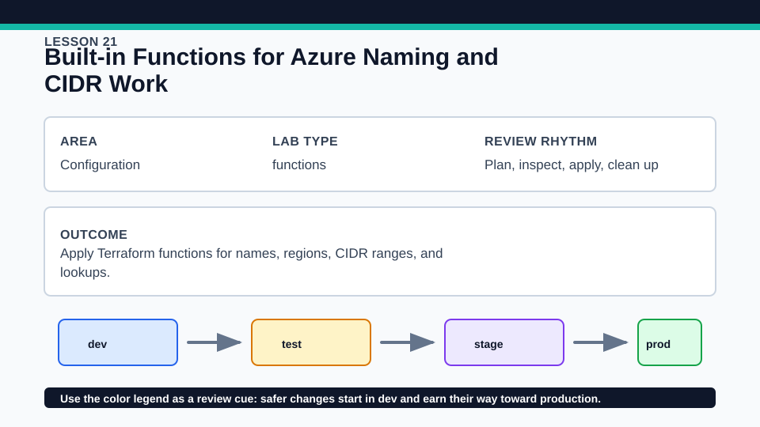
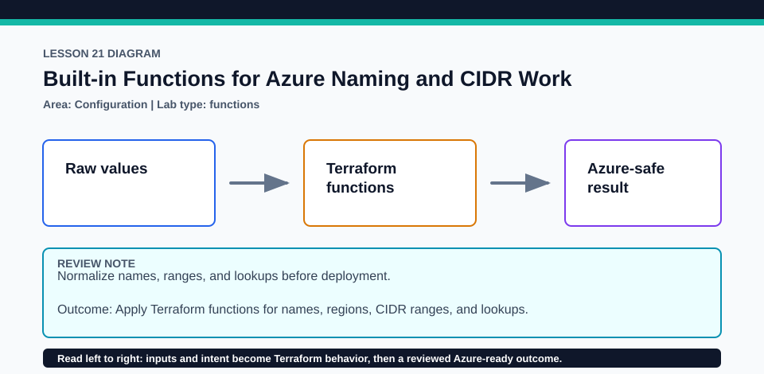

# Lesson 21: Built-in Functions for Azure Naming and CIDR Work

Function knowledge is provider-neutral even though the naming and CIDR examples use Azure conventions.

## Certification alignment

- `4e` — Write dynamic configuration using expressions and functions — **hands-on**: Built-in string, collection, lookup, and CIDR functions transform local inputs into repeatable network values.

## Scenario

A hub-and-spoke prototype needs deterministic subnet names and non-overlapping ranges.

## Walkthrough

1. Identify every built-in function in main.tf and state its input and return type.
2. Use terraform console to evaluate the naming and cidrsubnet expressions one step at a time.
3. Change a prefix or network index and predict the output before rerunning plan.
4. Add one harmless local expression in a disposable copy and format, validate, and review it.

Baseline commands for this lesson:

```powershell
Set-Location lab
terraform init -lockfile=readonly
terraform fmt -check
terraform validate
terraform plan
```

## Expected results

- Outputs show normalized Azure-safe names and deterministic CIDR ranges.
- The same inputs always produce the same pure-function results.
- An invalid CIDR or out-of-range subnet index produces a focused evaluation error.

## Failure modes

- Over-normalizing names can create collisions that the cloud API later rejects.
- Incorrect newbits or netnum values can create overlapping or invalid subnets.
- lookup with an unsafe default can silently hide a missing required key.

## Wiki




## Cleanup

- Destroy the local contract if applied and exit terraform console.
- Remove disposable expressions and console transcripts after comparison.
- Remove generated `.terraform/`, plan files, state files, debug logs, copied `terraform.tfvars`, and generated secrets only after any required destroy or migration is complete.
- If this root has a committed `.terraform.lock.hcl`, keep it. Never delete a root lock file as routine cleanup; update it only during an intentional, reviewed dependency upgrade.
- Do not commit credentials, real secret values, state, plan files, backend credentials, or local variable files.

## Check questions

1. Which functions are pure transformations?
2. How do newbits and netnum affect cidrsubnet?
3. When should a failed lookup be preferred over a default?

