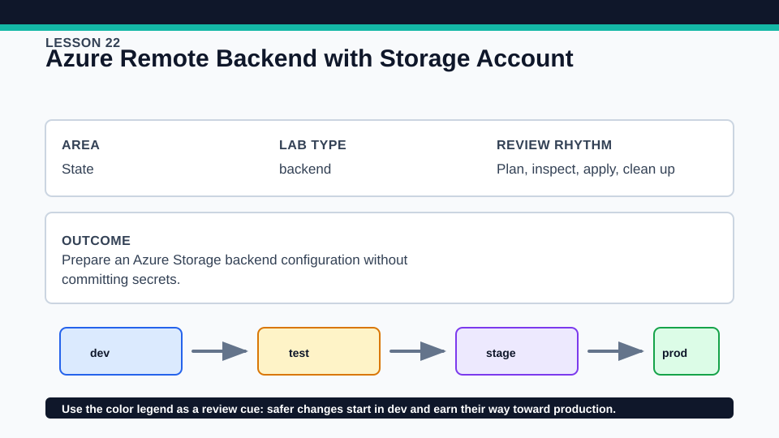
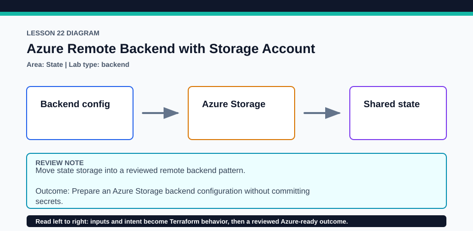

# Lesson 22: Azure Remote Backend with Storage Account

This advanced Azure lab is optional to apply but its migration and cleanup order is mandatory reading.

## Certification alignment

- `2d` — Explain how Terraform uses and manages state — **hands-on**: The bootstrap and workload roots exercise local state, Azure Blob locking, and an azurerm backend migration using use_azuread_auth and Azure CLI authentication.
- `6a` — Describe the local backend — **guided**: The bootstrap and workload roots exercise local state, Azure Blob locking, and an azurerm backend migration using use_azuread_auth and Azure CLI authentication.
- `6b` — Describe state locking — **hands-on**: The bootstrap and workload roots exercise local state, Azure Blob locking, and an azurerm backend migration using use_azuread_auth and Azure CLI authentication.
- `6c` — Configure remote state using the backend block — **hands-on**: The bootstrap and workload roots exercise local state, Azure Blob locking, and an azurerm backend migration using use_azuread_auth and Azure CLI authentication.

## Scenario

A team is moving workload state from a laptop to an Azure Storage backend protected by Microsoft Entra ID.

## Walkthrough

1. In lab/bootstrap, confirm required provider registrations, plan the resource group, storage account, private container, and Storage Blob Data Contributor assignment for the current CLI principal, then apply only when authorized.
2. Copy the bootstrap outputs into an untracked backend configuration based on backend.azurerm.tfbackend.example; do not place credentials in it.
3. In lab, initialize locally, apply the tiny workload, back up the local state securely, then run terraform init -migrate-state -backend-config=backend.azurerm.tfbackend and approve the migration.
4. Run terraform state list and a no-change plan against the Azure backend, then rehearse the safe reverse order for cleanup.

Baseline commands for this lesson:

```powershell
az account show
Set-Location lab/bootstrap
Copy-Item terraform.tfvars.example terraform.tfvars
terraform init -lockfile=readonly
terraform plan -out=tfplan
```

The plan is credentialed but non-mutating. Apply only in a disposable subscription after confirming the active tenant, subscription, names, region, cost, and every proposed replacement or deletion.

## Expected results

- Bootstrap outputs provide resource group, storage account, container, key, use_azuread_auth, and use_cli settings without a storage key.
- The workload begins in local state and is subsequently visible through the initialized remote backend.
- Concurrent state-writing operations are protected by Azure Blob locking while data-plane access uses least-privilege Entra authorization.

## Failure modes

- Contributor on the resource group does not automatically grant Blob data-plane access.
- Destroying the storage account before the workload removes the backend needed to destroy or inspect that workload.
- Backend blocks cannot read normal input variables, and a committed backend file must not contain credentials.

## Wiki




## Cleanup

- Destroy the workload while the Azure backend still exists and verify its remote state contains no managed workload objects.
- Only after workload cleanup, reinitialize lab/bootstrap, destroy the role assignment, container/storage account, and resource group, and verify deletion.
- Delete local state backups and untracked backend configuration only after migration and cleanup are confirmed; preserve both root lock files.
- Remove generated `.terraform/`, plan files, state files, debug logs, copied `terraform.tfvars`, and generated secrets only after any required destroy or migration is complete.
- If this root has a committed `.terraform.lock.hcl`, keep it. Never delete a root lock file as routine cleanup; update it only during an intentional, reviewed dependency upgrade.
- Do not commit credentials, real secret values, state, plan files, backend credentials, or local variable files.

## Check questions

1. Why does the backend bootstrap need a separate root and state?
2. Which role grants blob data-plane access, and why is management-plane Contributor insufficient?
3. What exact cleanup ordering prevents loss of access to workload state?

