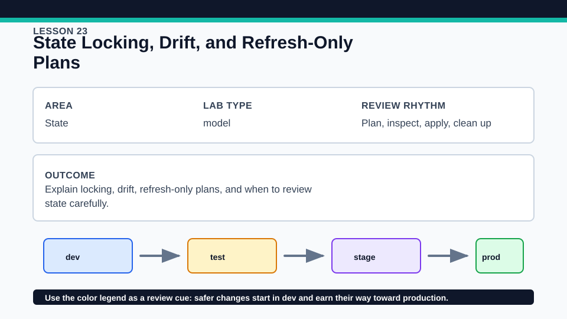
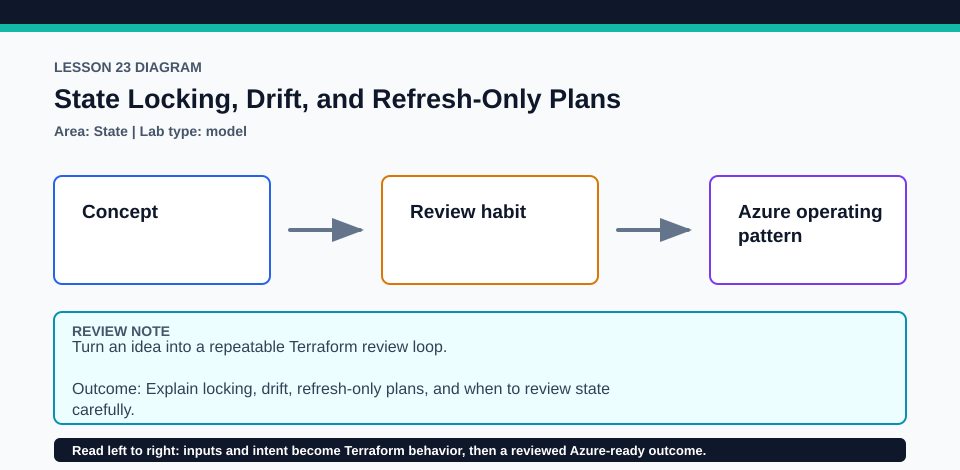

# Lesson 23: State Locking, Drift, and Refresh-Only Plans

All drift and contention work is local and disposable; no Azure login is required.

## Certification alignment

- `2d` — Explain how Terraform uses and manages state — **hands-on**: The local_file target and disposable Invoke-DriftAndLockDemo.ps1 exercise perform drift detection, refresh-only planning, and real lock contention without touching tracked fixtures.
- `6a` — Describe the local backend — **hands-on**: The local_file target and disposable Invoke-DriftAndLockDemo.ps1 exercise perform drift detection, refresh-only planning, and real lock contention without touching tracked fixtures.
- `6b` — Describe state locking — **hands-on**: The local_file target and disposable Invoke-DriftAndLockDemo.ps1 exercise perform drift detection, refresh-only planning, and real lock contention without touching tracked fixtures.
- `6d` — Manage resource drift and Terraform state — **hands-on**: The local_file target and disposable Invoke-DriftAndLockDemo.ps1 exercise perform drift detection, refresh-only planning, and real lock contention without touching tracked fixtures.

## Scenario

A dashboard-owned file was changed outside Terraform and the team must review drift while another operation may hold the state lock.

## Walkthrough

1. Review the local_file resource and predict what a normal plan would do after an out-of-band edit.
2. From the lesson root, run ./exercise/Invoke-DriftAndLockDemo.ps1; the script copies the lab to a unique temporary directory.
3. Observe the external file mutation, the refresh-only plan, and the competing operation blocked by the held lock.
4. Compare a normal corrective plan with refresh-only mode and record which one would change the file versus only state and outputs.

Baseline commands for this lesson:

```powershell
Set-Location lab
terraform init -lockfile=readonly
terraform validate
terraform plan
```

## Expected results

- The script applies a local file, mutates it outside Terraform, and shows the drift in a refresh-only plan.
- A concurrent writer receives a lock error while the lock-holder process is active.
- The script's finally block removes the unique temporary directory and leaves the tracked lab unchanged.

## Failure modes

- Force-unlocking an active operation can enable concurrent state writes and corruption.
- A refresh-only plan can accept observed drift into state; it does not restore the configured file content.
- Terminating the demo abruptly may require checking for a surviving lock-holder process before rerun.

## Wiki




## Cleanup

- Let the script finish so its finally block stops the lock process and deletes the temporary directory.
- If running steps manually in another disposable directory, destroy the local_file resource before deleting state.
- Confirm no lesson-23 temporary directory, generated file, or lock process remains.
- Remove generated `.terraform/`, plan files, state files, debug logs, copied `terraform.tfvars`, and generated secrets only after any required destroy or migration is complete.
- If this root has a committed `.terraform.lock.hcl`, keep it. Never delete a root lock file as routine cleanup; update it only during an intentional, reviewed dependency upgrade.
- Do not commit credentials, real secret values, state, plan files, backend credentials, or local variable files.

## Check questions

1. What different actions do normal and refresh-only plans propose after the file edit?
2. How do you prove a lock is stale before force-unlock?
3. Why is the tracked lab copied rather than modified in place?

