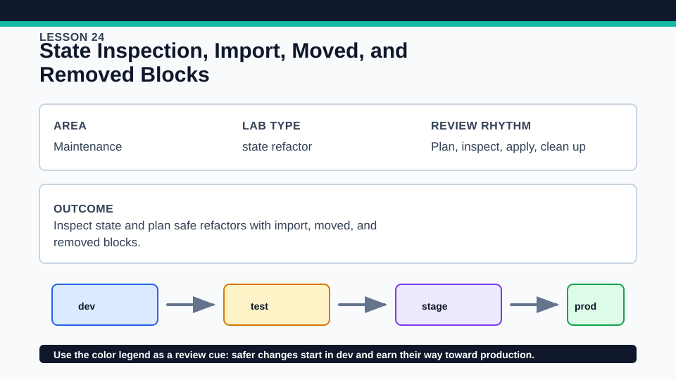
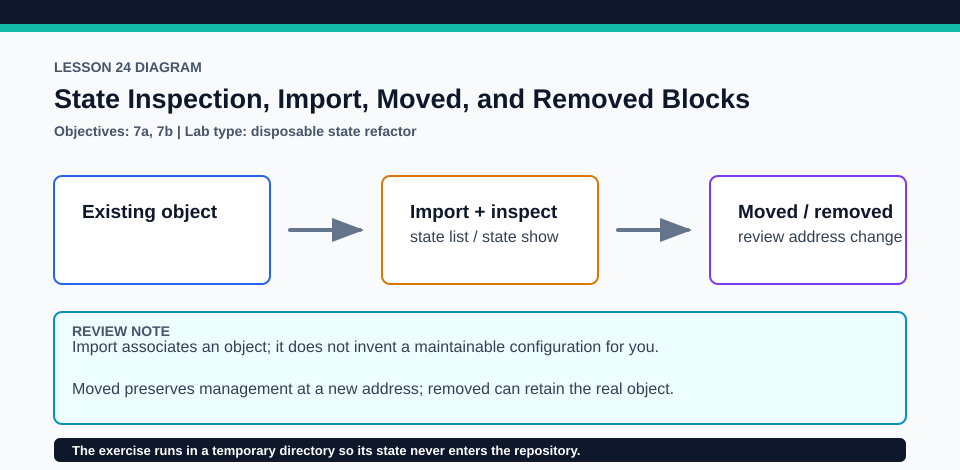

# Lesson 24: State Inspection, Import, Moved, and Removed Blocks

The exercise uses a synthetic Random provider ID so no Azure resource or tracked fixture is at risk.

## Certification alignment

- `2d` — Explain how Terraform uses and manages state — **hands-on**: The disposable Invoke-StateLifecycleDemo.ps1 imports an existing random_id, runs state list/show, applies a moved block, and finishes with a removed block using destroy = false.
- `6d` — Manage resource drift and Terraform state — **hands-on**: The disposable Invoke-StateLifecycleDemo.ps1 imports an existing random_id, runs state list/show, applies a moved block, and finishes with a removed block using destroy = false.
- `7a` — Import existing infrastructure into your Terraform workspace — **hands-on**: The disposable Invoke-StateLifecycleDemo.ps1 imports an existing random_id, runs state list/show, applies a moved block, and finishes with a removed block using destroy = false.
- `7b` — Use the CLI to inspect state — **hands-on**: The disposable Invoke-StateLifecycleDemo.ps1 imports an existing random_id, runs state list/show, applies a moved block, and finishes with a removed block using destroy = false.

## Scenario

A managed identifier must pass through import, state inspection, address refactoring, and intentional removal from management.

## Walkthrough

1. Read the three staged .tf.example files without renaming them in the tracked tree.
2. From the lesson root, run ./exercise/Invoke-StateLifecycleDemo.ps1; it builds an isolated temporary root and imports the ID p-9hUg.
3. Observe terraform state list and terraform state show after import, then inspect the plan that moves random_id.legacy to random_id.service.
4. Inspect the final removed block and confirm state becomes empty without editing tracked fixtures or deleting the synthetic remote identifier.

Baseline commands for this lesson:

```powershell
Set-Location lab
terraform init -lockfile=readonly
terraform validate
terraform plan
```

## Expected results

- Import associates p-9hUg with the staged resource address and state inspection displays its attributes.
- The moved stage changes the address without replacing the random ID.
- The removed stage with destroy = false ends Terraform management and the final state list is empty.

## Failure modes

- Importing into the wrong address creates an incorrect state relationship that must be corrected before apply.
- Deleting a resource block without a moved or removed transition can propose unintended destruction.
- A removed block with destroy = true or an ordinary deletion has different object-lifecycle consequences.

## Wiki




## Cleanup

- Allow the script's finally block to delete its temporary working directory.
- For a manual disposable run, ensure state list is empty or destroy the synthetic local object before removing state.
- Confirm no generated main.tf, state, plan, or import artifact appears in the tracked lesson.
- Remove generated `.terraform/`, plan files, state files, debug logs, copied `terraform.tfvars`, and generated secrets only after any required destroy or migration is complete.
- If this root has a committed `.terraform.lock.hcl`, keep it. Never delete a root lock file as routine cleanup; update it only during an intentional, reviewed dependency upgrade.
- Do not commit credentials, real secret values, state, plan files, backend credentials, or local variable files.

## Check questions

1. What two identifiers are required for import?
2. How does a moved block differ from state mv?
3. Why does destroy = false require an explicit ownership handoff decision?

