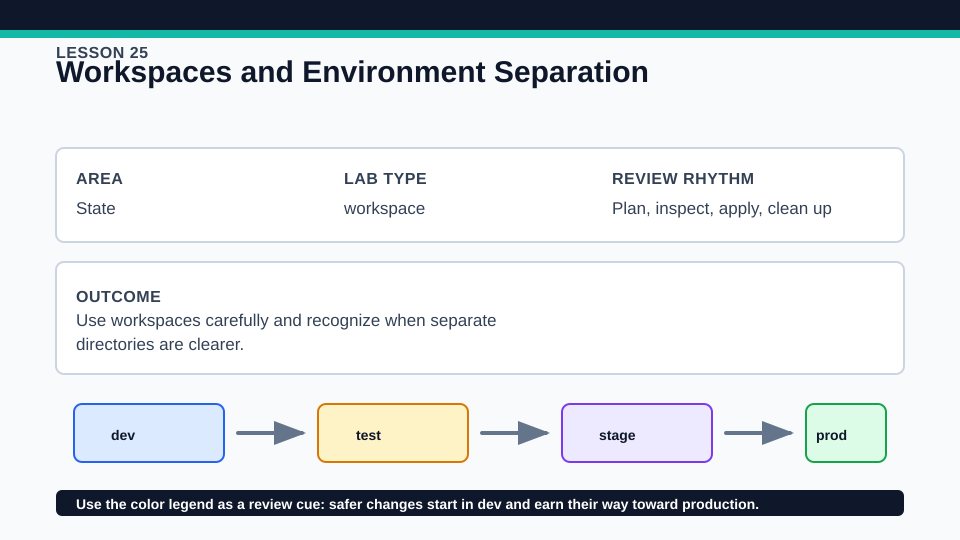
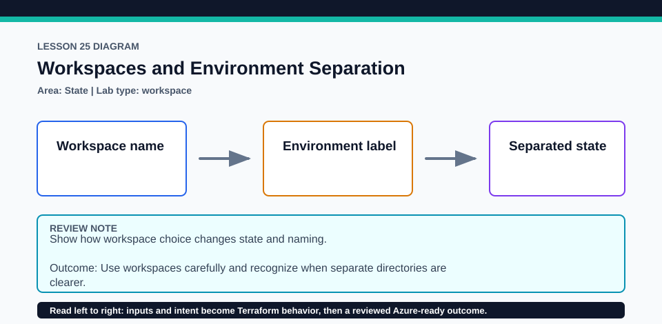

# Lesson 25: Workspaces and Environment Separation

CLI workspaces are useful for this small exercise, not a universal environment-isolation architecture.

## Certification alignment

- `2d` — Explain how Terraform uses and manages state — **hands-on**: Local CLI workspaces create separate state instances so their outputs and managed local contracts can be compared.
- `6a` — Describe the local backend — **hands-on**: Local CLI workspaces create separate state instances so their outputs and managed local contracts can be compared.

## Scenario

A small training lab tracks dev and test instances from the same configuration.

## Walkthrough

1. Run terraform workspace list and identify the current workspace before applying anything.
2. Create dev and test workspaces, plan each with distinct non-secret inputs, and inspect terraform.workspace in the output.
3. Apply only local terraform_data instances if you want to compare workspace-isolated state lists.
4. Explain when separate roots, backends, credentials, and access controls are safer than CLI workspaces.

Baseline commands for this lesson:

```powershell
Set-Location lab
terraform init -lockfile=readonly
terraform fmt -check
terraform validate
terraform plan
```

## Expected results

- Each workspace has an independent state snapshot for the same configuration.
- Switching workspaces changes the selected state and the workspace-derived output.
- Objects in dev state do not appear in terraform state list while test is selected.

## Failure modes

- Applying in the wrong selected workspace updates the wrong state instance.
- CLI workspaces do not by themselves provide strong environment access isolation.
- Deleting a nonempty workspace fails or tempts unsafe force deletion.

## Wiki




## Cleanup

- Destroy the local instance in every nondefault workspace before deleting that workspace.
- Switch back to default, verify workspace list, and remove only generated local state after all instances are destroyed.
- Remove generated `.terraform/`, plan files, state files, debug logs, copied `terraform.tfvars`, and generated secrets only after any required destroy or migration is complete.
- If this root has a committed `.terraform.lock.hcl`, keep it. Never delete a root lock file as routine cleanup; update it only during an intentional, reviewed dependency upgrade.
- Do not commit credentials, real secret values, state, plan files, backend credentials, or local variable files.

## Check questions

1. What does a CLI workspace isolate, and what does it share?
2. How can a pipeline prove it selected the intended workspace?
3. When should production use a separate root instead?

