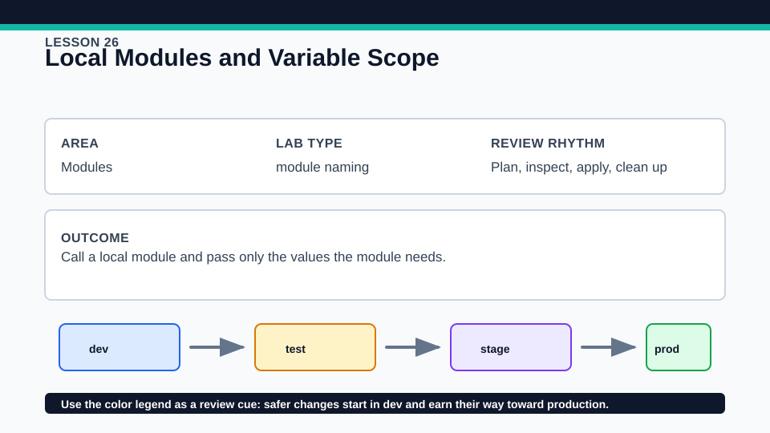
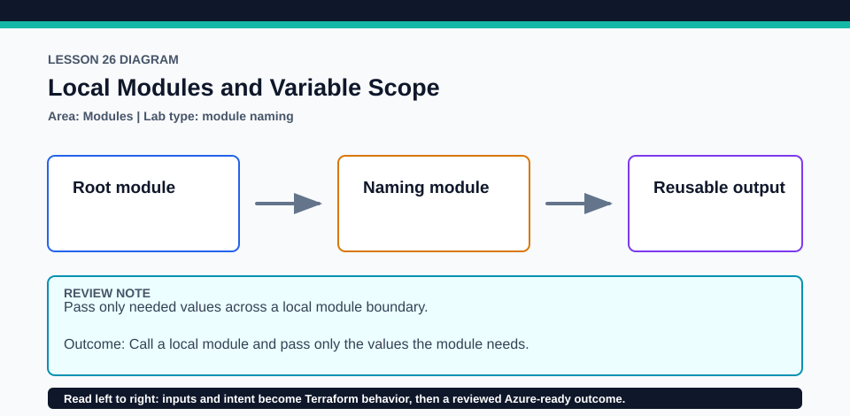

# Lesson 26: Local Modules and Variable Scope

Reusable child modules rely on root-module provider selections and should not carry their own dependency lock files.

## Certification alignment

- `5b` — Describe variable scope within modules — **hands-on**: A local child module receives explicit input variables and publishes outputs, demonstrating module scope and use without cloud credentials.
- `5c` — Use modules in configuration — **hands-on**: A local child module receives explicit input variables and publishes outputs, demonstrating module scope and use without cloud credentials.

## Scenario

The team extracts naming rules so application, storage, and monitoring configurations agree.

## Walkthrough

1. Open the root module and shared naming module side by side.
2. Trace each module argument to a declared child variable and each downstream reference to a child output.
3. Plan with two prefixes and compare the module's deterministic result.
4. Try to reference a child local directly in a disposable copy and interpret the scope error.

Baseline commands for this lesson:

```powershell
Set-Location lab
terraform init -lockfile=readonly
terraform fmt -check
terraform validate
terraform plan
```

## Expected results

- The root plan calls the local module by relative path and exposes its output.
- Only declared inputs cross into the child and only outputs cross back to the parent.
- Internal child locals remain inaccessible to the caller.

## Failure modes

- A wrong relative source path makes init unable to install the module.
- Adding an undeclared module argument or omitting a required input fails validation.
- Assuming parent locals are visible inside the child breaks module encapsulation.

## Wiki




## Cleanup

- Destroy any local root resources if applied; the child module has no separate state to clean.
- Remove generated module cache data only after the root is no longer in use; keep root locks and child source.
- Remove generated `.terraform/`, plan files, state files, debug logs, copied `terraform.tfvars`, and generated secrets only after any required destroy or migration is complete.
- If this root has a committed `.terraform.lock.hcl`, keep it. Never delete a root lock file as routine cleanup; update it only during an intentional, reviewed dependency upgrade.
- Do not commit credentials, real secret values, state, plan files, backend credentials, or local variable files.

## Check questions

1. Which values cross the parent-child boundary?
2. Why can the parent not read a child local?
3. What makes an output part of the module's public contract?

