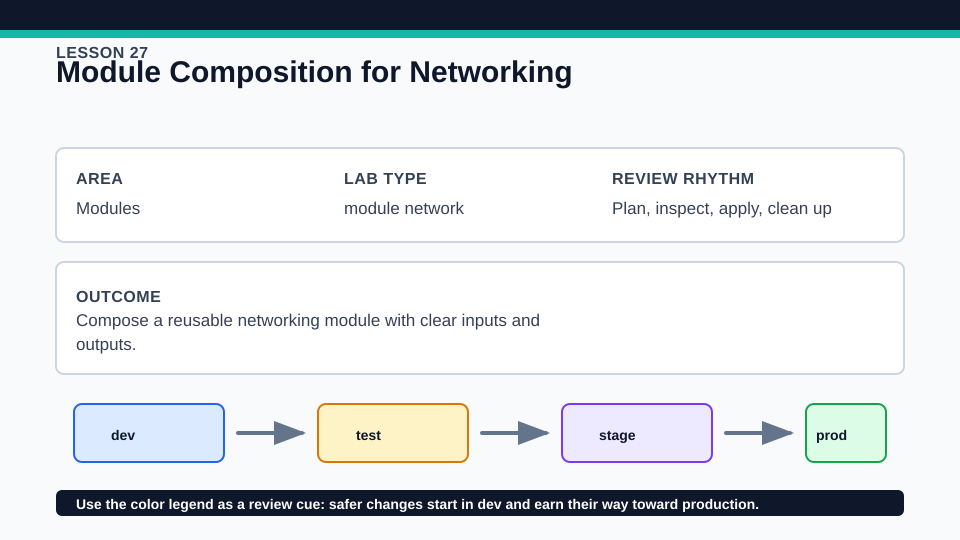
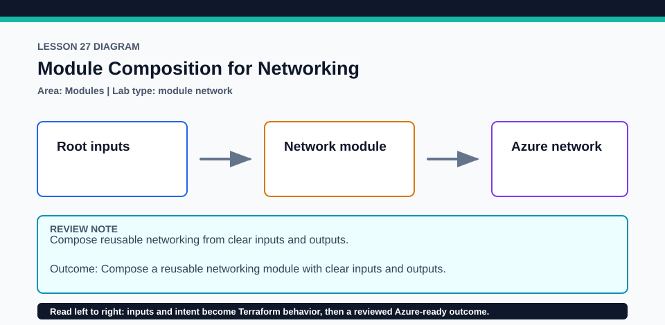

# Lesson 27: Module Composition for Networking

Module composition should expose the smallest stable interface needed by downstream consumers.

## Certification alignment

- `5b` — Describe variable scope within modules — **hands-on**: The Azure root composes a local networking module through typed inputs, provider inheritance, and outputs used by downstream configuration.
- `5c` — Use modules in configuration — **hands-on**: The Azure root composes a local networking module through typed inputs, provider inheritance, and outputs used by downstream configuration.

## Scenario

A product squad needs a compact virtual network foundation for multiple application tiers.

## Walkthrough

1. Review the child module's variables, resources, and outputs before the root call.
2. Trace the AzureRM provider requirement from root to child without adding a lock file inside shared/modules.
3. Plan the virtual network and subnets, then map root inputs to child resources and child outputs back to the root.
4. Change one subnet in a disposable input and inspect the focused module-addressed plan.

Baseline commands for this lesson:

```powershell
az account show
Set-Location lab
Copy-Item terraform.tfvars.example terraform.tfvars
terraform init -lockfile=readonly
terraform fmt -check
terraform validate
terraform plan -out=tfplan
```

The plan is credentialed but non-mutating. Apply only in a disposable subscription after confirming the active tenant, subscription, names, region, cost, and every proposed replacement or deletion.

## Expected results

- The plan shows resource addresses beneath module.network or the lesson's named module call.
- The child receives only its declared network values and returns selected IDs or names.
- Provider selection and lock ownership remain at the root module.

## Failure modes

- Overlapping or invalid CIDR ranges can pass module structure checks but fail validation or Azure rules.
- Renaming the module call changes resource addresses and needs a moved transition for existing state.
- Pinning providers only inside a child can conflict with root selection and reuse.

## Wiki




## Cleanup

- If applied, destroy the network root so child-managed Azure resources are removed in dependency order.
- Delete copied inputs after destroy; keep the root lock and never add a lock inside the reusable child module.
- Remove generated `.terraform/`, plan files, state files, debug logs, copied `terraform.tfvars`, and generated secrets only after any required destroy or migration is complete.
- If this root has a committed `.terraform.lock.hcl`, keep it. Never delete a root lock file as routine cleanup; update it only during an intentional, reviewed dependency upgrade.
- Do not commit credentials, real secret values, state, plan files, backend credentials, or local variable files.

## Check questions

1. Which provider configuration does the child use?
2. What output enables safe downstream composition without exposing every resource?
3. How would a module call rename affect existing addresses?

