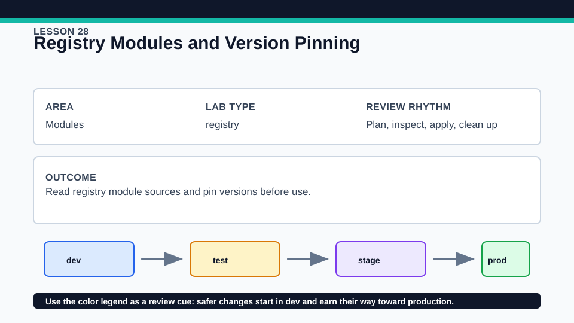
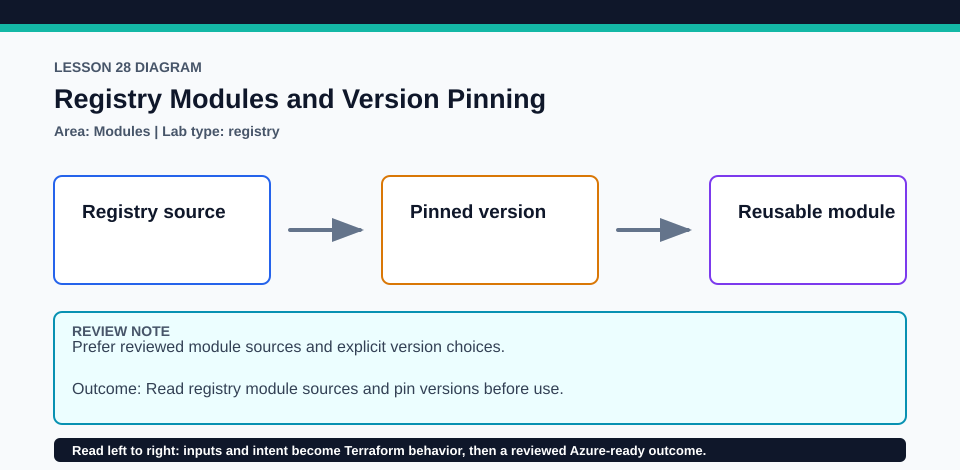

# Lesson 28: Registry Modules and Version Pinning

Lesson 28 is the primary hands-on source and version evidence; no Azure account is required.

## Certification alignment

- `5a` — Explain how Terraform sources modules — **hands-on**: The active `hashicorp/subnets/cidr` module is pinned to `1.0.0` and produces three CIDRs; the AVM virtual-network example remains review-only with `version = "~> 0.19"`.
- `5d` — Manage module versions — **hands-on**: The active `hashicorp/subnets/cidr` module is pinned to `1.0.0` and produces three CIDRs; the AVM virtual-network example remains review-only with `version = "~> 0.19"`.

## Scenario

A team evaluates a public registry module and records an Azure module review before adoption.

## Walkthrough

1. Inspect the active registry source and exact version, then run init and terraform providers to see the installed module tree.
2. Run the credential-free test and plan; verify the module returns three nonoverlapping CIDRs.
3. Review `avm-virtual-network.tf.example` without enabling it, including its source, `~> 0.19` version policy, `parent_id`, provider requirements, inputs, outputs, and planned Azure scope.
4. In a disposable copy only, adjust the active module constraint, run init -upgrade, and review source and behavior before adopting any change.

Baseline commands for this lesson:

```powershell
Set-Location lab
terraform init -lockfile=readonly
terraform fmt -check
terraform validate
terraform plan
```

## Expected results

- Initialization downloads hashicorp/subnets/cidr 1.0.0 and the plan exposes three derived networks.
- The test proves the expected output count without Azure credentials.
- The AVM example documents the current 0.19-compatible interface but creates no Azure resources in this lab.

## Failure modes

- A registry source typo or unavailable version makes init fail.
- Floating constraints can adopt breaking module behavior without review.
- Uncommenting the AVM example without Azure context, parent_id, and review changes a no-cost lab into a cloud deployment.

## Wiki




## Cleanup

- Destroy the local active-module state if anything was applied.
- Delete the disposable upgrade copy and generated module cache; keep the root lock and the tracked review-only AVM example.
- Remove generated `.terraform/`, plan files, state files, debug logs, copied `terraform.tfvars`, and generated secrets only after any required destroy or migration is complete.
- If this root has a committed `.terraform.lock.hcl`, keep it. Never delete a root lock file as routine cleanup; update it only during an intentional, reviewed dependency upgrade.
- Do not commit credentials, real secret values, state, plan files, backend credentials, or local variable files.

## Check questions

1. What does the module version argument control that the provider lock does not?
2. Which evidence establishes module provenance and interface compatibility?
3. Why is the AVM example review-only while the CIDR module is active?

