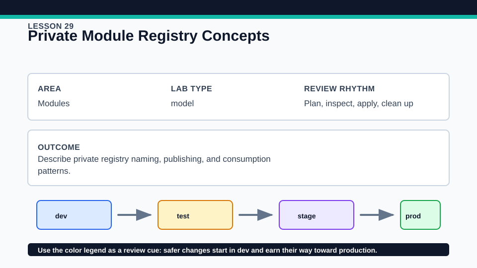
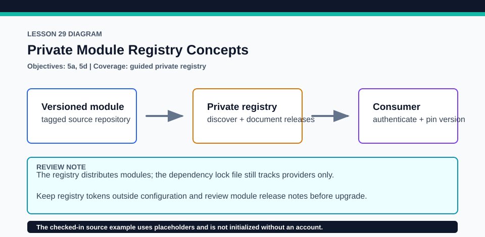

# Lesson 29: Private Module Registry Concepts

Private registry use and paid governance features are guided because they require organization-specific external services.

## Certification alignment

- `5a` — Explain how Terraform sources modules — **guided**: The guided private-registry example covers authenticated module discovery, version publishing, and consumption; the active local lab remains account-free.
- `5d` — Manage module versions — **guided**: The guided private-registry example covers authenticated module discovery, version publishing, and consumption; the active local lab remains account-free.
- `8b` — Describe HCP Terraform collaboration and governance features — **conceptual**: The guided private-registry example covers authenticated module discovery, version publishing, and consumption; the active local lab remains account-free.

## Scenario

An organization wants shared golden modules for application teams without copy-paste drift.

## Walkthrough

1. Run the local baseline to validate the account-free lesson contract.
2. Inspect `lab/private-module-call.tf.example` and identify the hostname, organization, namespace, name, and provider segments in its private module source.
3. Optionally, with an authorized HCP Terraform account and a published private module, authenticate and initialize the example in a disposable copy.
4. Compare private-registry discovery, version governance, and access control with the public registry module from Lesson 28.

Baseline commands for this lesson:

```powershell
Set-Location lab
terraform init -lockfile=readonly
terraform validate
terraform plan
```

The local validation path requires no HCP account. Any HCP Terraform procedure below is **optional**, uses an external account, and must be cleaned up in that account when complete.

## Expected results

- Local validation succeeds without contacting a private registry.
- An optional authorized init resolves only module versions the account can access.
- The review identifies publishing and consumption as separate workflows.

## Failure modes

- A private registry returns authorization or not-found errors when the token lacks access.
- An unpublished or mistyped version prevents init from resolving the module.
- Treating registry availability as proof of security skips code, provenance, interface, and plan review.

## Wiki




## Cleanup

- Destroy any local contract applied in the account-free lab.
- For optional HCP work, remove the disposable consumer, revoke unneeded tokens, and leave shared module versions untouched unless you own them.
- Remove generated `.terraform/`, plan files, state files, debug logs, copied `terraform.tfvars`, and generated secrets only after any required destroy or migration is complete.
- If this root has a committed `.terraform.lock.hcl`, keep it. Never delete a root lock file as routine cleanup; update it only during an intentional, reviewed dependency upgrade.
- Do not commit credentials, real secret values, state, plan files, backend credentials, or local variable files.

## Check questions

1. Which segments make a private module source address unambiguous?
2. Who should be allowed to publish a new version?
3. What review remains necessary after access succeeds?

