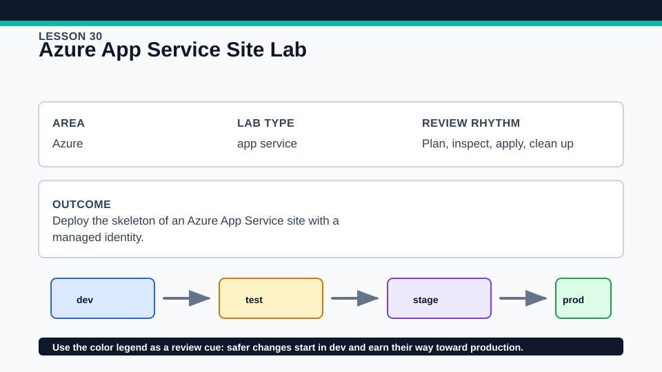
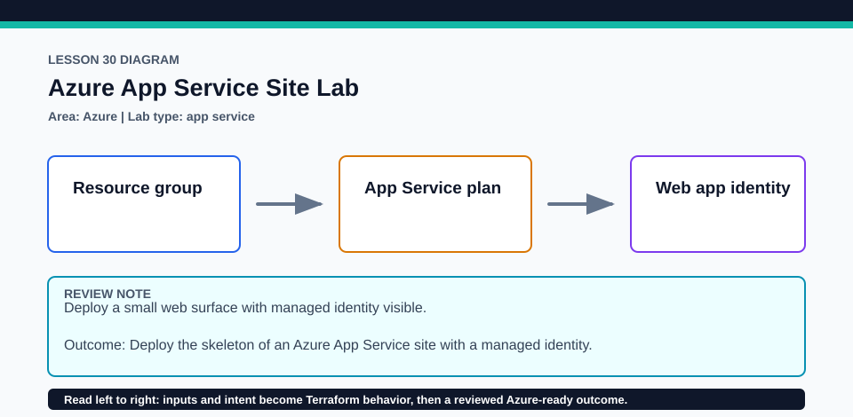

# Lesson 30: Azure App Service Site Lab

This optional Azure lab can incur cost; use a disposable subscription, budget, and prompt cleanup.

## Certification alignment

- `2c` — Write Terraform configuration using multiple providers — **hands-on**: AzureRM and Random providers compose a resource group, App Service plan, and managed-identity web app using the current Node 24-lts runtime.
- `3d` — Generate and review an execution plan for Terraform — **hands-on**: AzureRM and Random providers compose a resource group, App Service plan, and managed-identity web app using the current Node 24-lts runtime.
- `3e` — Apply changes to infrastructure with Terraform — **hands-on**: AzureRM and Random providers compose a resource group, App Service plan, and managed-identity web app using the current Node 24-lts runtime.
- `3f` — Destroy Terraform-managed infrastructure — **hands-on**: AzureRM and Random providers compose a resource group, App Service plan, and managed-identity web app using the current Node 24-lts runtime.
- `4b` — Refer to resource attributes and create cross-resource references — **hands-on**: AzureRM and Random providers compose a resource group, App Service plan, and managed-identity web app using the current Node 24-lts runtime.

## Scenario

A conference operations team needs a simple check-in web endpoint.

## Walkthrough

1. Inspect required_providers and trace the random suffix into Azure names without confusing the two provider responsibilities.
2. Review the App Service plan SKU, Node 24-lts setting, HTTPS configuration, and managed identity.
3. Run the mocked test if present, then review the credentialed plan for all creates and cross-resource references.
4. Apply only after a cost check, verify the endpoint and identity output, then run a no-change plan.

Baseline commands for this lesson:

```powershell
az account show
Set-Location lab
Copy-Item terraform.tfvars.example terraform.tfvars
terraform init -lockfile=readonly
terraform fmt -check
terraform validate
terraform plan -out=tfplan
```

The plan is credentialed but non-mutating. Apply only in a disposable subscription after confirming the active tenant, subscription, names, region, cost, and every proposed replacement or deletion.

## Expected results

- The plan shows Random and AzureRM provider operations and the expected App Service resource chain.
- The web app references its plan and resource group and reports a managed identity.
- A successful apply returns the site hostname or URL and a second plan is empty.

## Failure modes

- An unavailable region/SKU combination or subscription quota can reject the plan or apply.
- Globally unique web-app names can collide despite a short suffix.
- Changing replacement-sensitive names or plan properties can propose recreation and downtime.

## Wiki




## Cleanup

- If applied, run terraform destroy and verify the web app, plan, and resource group are removed.
- Check for deployment or monitoring resources added manually outside this root before considering cleanup complete.
- Remove generated `.terraform/`, plan files, state files, debug logs, copied `terraform.tfvars`, and generated secrets only after any required destroy or migration is complete.
- If this root has a committed `.terraform.lock.hcl`, keep it. Never delete a root lock file as routine cleanup; update it only during an intentional, reviewed dependency upgrade.
- Do not commit credentials, real secret values, state, plan files, backend credentials, or local variable files.

## Check questions

1. Which resources use Random versus AzureRM?
2. What plan evidence shows the web app depends on the service plan?
3. Which runtime and identity settings would you verify after apply?

