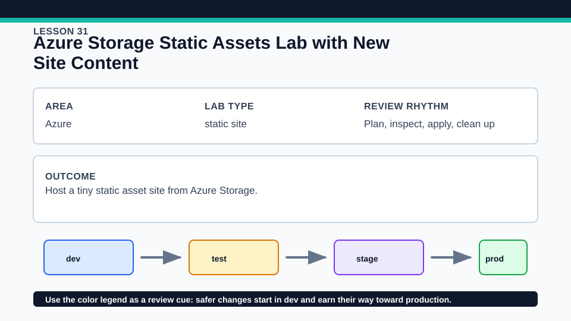
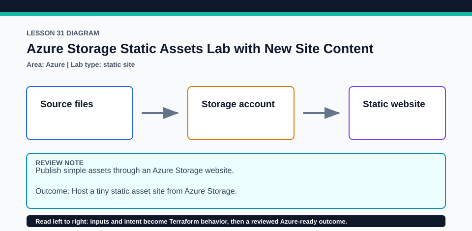

# Lesson 31: Azure Storage Static Assets Lab with New Site Content

The HTML is intentionally tiny so the plan's infrastructure and content relationships remain visible.

## Certification alignment

- `3e` — Apply changes to infrastructure with Terraform — **hands-on**: The Azure Storage static-site resources reference one another while local content files become managed blob objects.
- `3f` — Destroy Terraform-managed infrastructure — **hands-on**: The Azure Storage static-site resources reference one another while local content files become managed blob objects.
- `4b` — Refer to resource attributes and create cross-resource references — **hands-on**: The Azure Storage static-site resources reference one another while local content files become managed blob objects.

## Scenario

A service-status page publishes a lightweight status and error page for support teams.

## Walkthrough

1. Review the site directory before tracing files into Terraform-managed storage objects.
2. Follow the resource group, storage account, static-website settings, and blob references in dependency order.
3. Run a credentialed plan and verify content type, source hash, and endpoint outputs.
4. If applied, request the index and 404 paths, change one test line in a disposable copy, and review the focused blob update.

Baseline commands for this lesson:

```powershell
az account show
Set-Location lab
Copy-Item terraform.tfvars.example terraform.tfvars
terraform init -lockfile=readonly
terraform fmt -check
terraform validate
terraform plan -out=tfplan
```

The plan is credentialed but non-mutating. Apply only in a disposable subscription after confirming the active tenant, subscription, names, region, cost, and every proposed replacement or deletion.

## Expected results

- The plan creates storage resources and uploads only the tracked static assets.
- Cross-resource references connect the container or static-site endpoint to content objects.
- The endpoint serves the current index and configured error document after apply.

## Failure modes

- Storage-account names are global and can collide or violate naming rules.
- A missing source file or wrong content type can make the site incomplete despite successful infrastructure creation.
- Public static-site behavior may conflict with an organization's network or data-exposure policy.

## Wiki




## Cleanup

- If applied, destroy uploaded content before the storage account through the normal dependency plan and verify the resource group is gone.
- Revert disposable site-content changes and remove copied inputs after destroy.
- Remove generated `.terraform/`, plan files, state files, debug logs, copied `terraform.tfvars`, and generated secrets only after any required destroy or migration is complete.
- If this root has a committed `.terraform.lock.hcl`, keep it. Never delete a root lock file as routine cleanup; update it only during an intentional, reviewed dependency upgrade.
- Do not commit credentials, real secret values, state, plan files, backend credentials, or local variable files.

## Check questions

1. Which reference orders content after storage configuration?
2. How does a source hash make content drift visible?
3. Which security review is required before enabling public static hosting?

