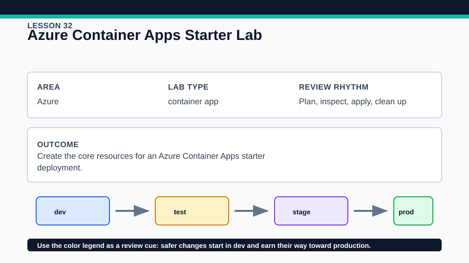
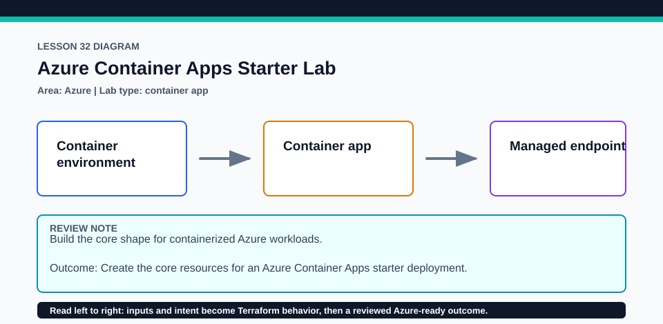

# Lesson 32: Azure Container Apps Starter Lab

This optional lab can incur both Container Apps and Log Analytics cost; destroy it promptly.

## Certification alignment

- `2c` — Write Terraform configuration using multiple providers — **hands-on**: Random and AzureRM resources compose Log Analytics, a Container Apps environment, and a managed-identity app pinned to an immutable quickstart image digest.
- `3e` — Apply changes to infrastructure with Terraform — **hands-on**: Random and AzureRM resources compose Log Analytics, a Container Apps environment, and a managed-identity app pinned to an immutable quickstart image digest.
- `3f` — Destroy Terraform-managed infrastructure — **hands-on**: Random and AzureRM resources compose Log Analytics, a Container Apps environment, and a managed-identity app pinned to an immutable quickstart image digest.
- `4b` — Refer to resource attributes and create cross-resource references — **hands-on**: Random and AzureRM resources compose Log Analytics, a Container Apps environment, and a managed-identity app pinned to an immutable quickstart image digest.

## Scenario

An image-processing queue demo needs a container app environment for later workers.

## Walkthrough

1. Trace the random suffix and every Azure cross-resource reference from resource group to workspace, environment, and app.
2. Verify the container image equals mcr.microsoft.com/k8se/quickstart at digest d24e95e1a58337150837336b665071af6bf823620ca9b27e71f9cb4c825434a0.
3. Review ingress, revision, CPU/memory, and managed-identity settings before planning.
4. Apply only after cost review, test the reported URL, then inspect revision health and a no-change plan.

Baseline commands for this lesson:

```powershell
az account show
Set-Location lab
Copy-Item terraform.tfvars.example terraform.tfvars
terraform init -lockfile=readonly
terraform fmt -check
terraform validate
terraform plan -out=tfplan
```

The plan is credentialed but non-mutating. Apply only in a disposable subscription after confirming the active tenant, subscription, names, region, cost, and every proposed replacement or deletion.

## Expected results

- The plan shows the Log Analytics workspace before the Container Apps environment and app.
- The deployed revision uses the immutable approved digest rather than a mutable tag.
- Outputs expose the app URL and managed-identity principal ID.

## Failure modes

- Container Apps or monitoring resource providers may be unregistered in the subscription.
- Regional capacity, quota, or an inaccessible image can prevent a healthy revision.
- Changing a digest or revision-sensitive template setting intentionally creates a new revision.

## Wiki




## Cleanup

- If applied, destroy the container app, environment, workspace, and resource group through Terraform and verify no revisions remain.
- Remove copied inputs and plan files after destroy; preserve both provider selections in the lock.
- Remove generated `.terraform/`, plan files, state files, debug logs, copied `terraform.tfvars`, and generated secrets only after any required destroy or migration is complete.
- If this root has a committed `.terraform.lock.hcl`, keep it. Never delete a root lock file as routine cleanup; update it only during an intentional, reviewed dependency upgrade.
- Do not commit credentials, real secret values, state, plan files, backend credentials, or local variable files.

## Check questions

1. Why is a digest safer than a mutable image tag?
2. Which reference connects the app environment to Log Analytics?
3. What Azure registration preflight would you run before apply?

