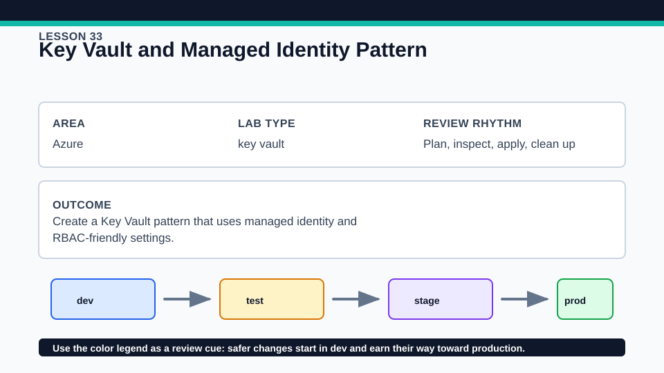
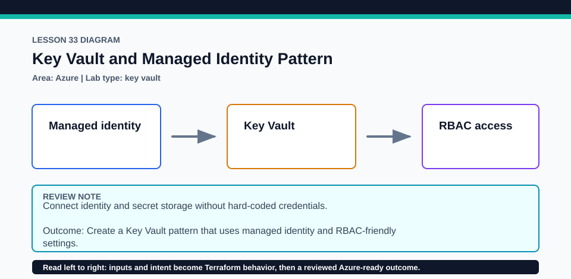

# Lesson 33: Key Vault and Managed Identity Pattern

This lesson demonstrates an Azure security pattern; Lesson 12 remains the primary sensitive-data and HashiCorp Vault evidence.

## Certification alignment

- `2c` — Write Terraform configuration using multiple providers — **hands-on**: AzureRM and Random create a Key Vault and user-assigned identity, while the guided comparison keeps Microsoft Azure Key Vault distinct from HashiCorp Vault in objective 4h.
- `4h` — Understand best practices for managing sensitive data, including secrets management with Vault — **guided**: AzureRM and Random create a Key Vault and user-assigned identity, while the guided comparison keeps Microsoft Azure Key Vault distinct from HashiCorp Vault in objective 4h.

## Scenario

A secure internal dashboard needs an identity and secret store without embedding application credentials.

## Walkthrough

1. Trace the random suffix into globally constrained names and review the managed identity and Key Vault RBAC settings.
2. Confirm that no secret value or client secret is created by the active lab.
3. Plan the resource group, identity, and vault, then inspect the URI and client-ID outputs.
4. Compare this Azure service pattern with Lesson 12's HashiCorp Vault provider example and state which product the official objective names.

Baseline commands for this lesson:

```powershell
az account show
Set-Location lab
Copy-Item terraform.tfvars.example terraform.tfvars
terraform init -lockfile=readonly
terraform fmt -check
terraform validate
terraform plan -out=tfplan
```

The plan is credentialed but non-mutating. Apply only in a disposable subscription after confirming the active tenant, subscription, names, region, cost, and every proposed replacement or deletion.

## Expected results

- The plan creates a Key Vault configured for RBAC authorization and a user-assigned managed identity.
- Outputs expose identifiers needed for later role assignment without outputting a secret.
- No HashiCorp Vault server, Vault provider, or secret value is implied by the Azure resource type.

## Failure modes

- Confusing Azure Key Vault with HashiCorp Vault produces inaccurate exam terminology.
- A managed identity has no access until an appropriate data-plane role assignment is added.
- Soft-delete and purge-protection settings can affect teardown timing and name reuse.

## Wiki




## Cleanup

- If applied, destroy all consumers and role assignments before destroying the identity, vault, and resource group.
- Verify the vault lifecycle outcome required by the subscription policy and remove copied inputs afterward.
- Remove generated `.terraform/`, plan files, state files, debug logs, copied `terraform.tfvars`, and generated secrets only after any required destroy or migration is complete.
- If this root has a committed `.terraform.lock.hcl`, keep it. Never delete a root lock file as routine cleanup; update it only during an intentional, reviewed dependency upgrade.
- Do not commit credentials, real secret values, state, plan files, backend credentials, or local variable files.

## Check questions

1. Which official product does objective 4h name?
2. Why does creating an identity not automatically grant vault access?
3. Which outputs are identifiers rather than secrets?

