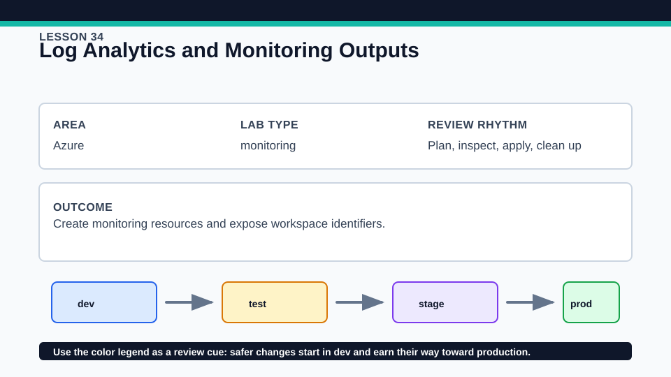
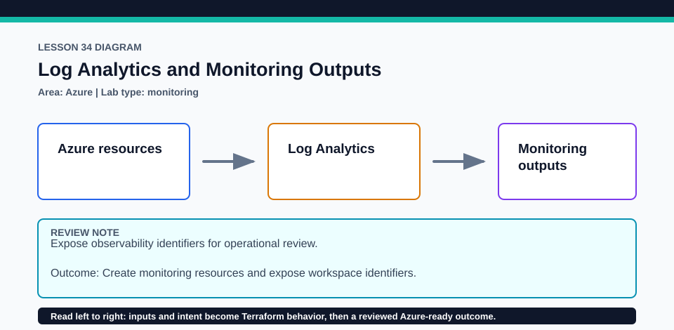

# Lesson 34: Log Analytics and Monitoring Outputs

Outputs are designed as a small operations interface, not a dump of every provider attribute.

## Certification alignment

- `3e` — Apply changes to infrastructure with Terraform — **hands-on**: AzureRM resources create a Log Analytics workspace and publish carefully selected workspace identifiers as outputs.
- `3f` — Destroy Terraform-managed infrastructure — **hands-on**: AzureRM resources create a Log Analytics workspace and publish carefully selected workspace identifiers as outputs.
- `4b` — Refer to resource attributes and create cross-resource references — **hands-on**: AzureRM resources create a Log Analytics workspace and publish carefully selected workspace identifiers as outputs.
- `4c` — Use variables and outputs — **hands-on**: AzureRM resources create a Log Analytics workspace and publish carefully selected workspace identifiers as outputs.

## Scenario

A platform team collects logs from application, container, and storage labs in one workspace.

## Walkthrough

1. Trace the resource-group reference into the workspace and each output back to a resource attribute.
2. Review retention, SKU, region, and tag inputs before planning.
3. Classify workspace_id and workspace_customer_id by intended consumer and sensitivity.
4. If applied, verify the workspace in Azure, read terraform output, and run a no-change plan.

Baseline commands for this lesson:

```powershell
az account show
Set-Location lab
Copy-Item terraform.tfvars.example terraform.tfvars
terraform init -lockfile=readonly
terraform fmt -check
terraform validate
terraform plan -out=tfplan
```

The plan is credentialed but non-mutating. Apply only in a disposable subscription after confirming the active tenant, subscription, names, region, cost, and every proposed replacement or deletion.

## Expected results

- The plan creates one resource group and one Log Analytics workspace.
- Outputs become known after apply and expose identifiers without publishing a shared key.
- A second plan reports no configuration drift.

## Failure modes

- Unsupported retention, policy, or regional settings can make the API reject the workspace.
- Publishing a shared key as a normal output would create an unnecessary secret exposure.
- Consumers can confuse the Azure resource ID with the workspace/customer ID if outputs are poorly named.

## Wiki




## Cleanup

- If applied, disconnect any resources added outside this lesson before destroying the workspace and resource group.
- Verify the workspace is removed and delete copied inputs or exported output JSON.
- Remove generated `.terraform/`, plan files, state files, debug logs, copied `terraform.tfvars`, and generated secrets only after any required destroy or migration is complete.
- If this root has a committed `.terraform.lock.hcl`, keep it. Never delete a root lock file as routine cleanup; update it only during an intentional, reviewed dependency upgrade.
- Do not commit credentials, real secret values, state, plan files, backend credentials, or local variable files.

## Check questions

1. Which output should an Azure resource reference?
2. Why should shared keys not be normal outputs?
3. What does an unknown output during plan indicate?

