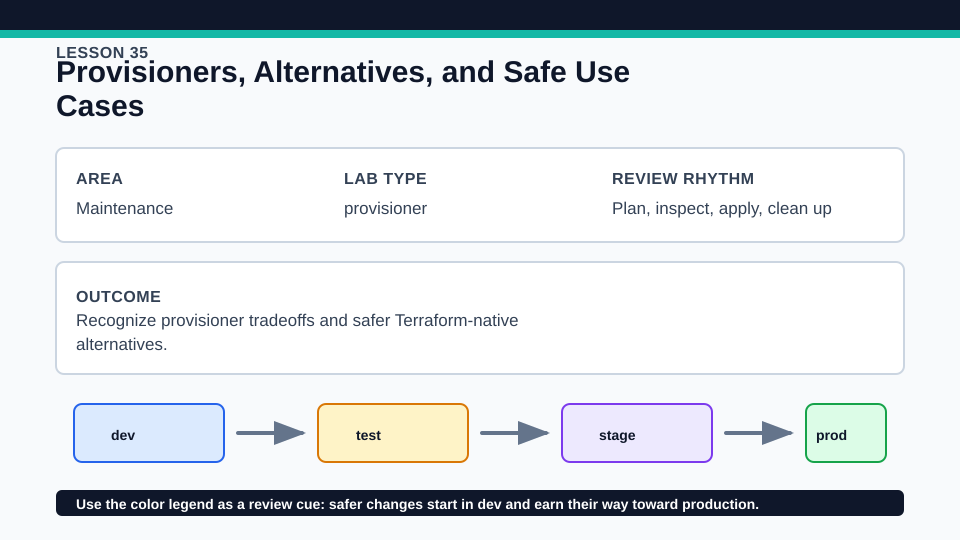
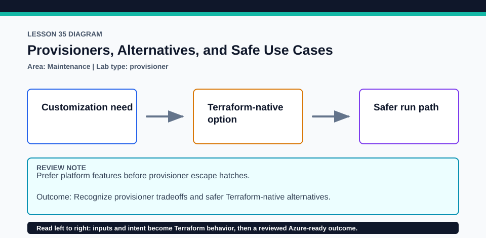

# Lesson 35: Provisioners, Alternatives, and Safe Use Cases

Provisioners remain a last resort; this lesson teaches the decision, not a copy-paste shell recipe.

## Certification alignment

- `2b` — Describe how Terraform uses providers — **hands-on**: The Local provider writes a runbook as a managed local_file while terraform_data records the provisioner decision, demonstrating an apply and a safer provider-native alternative.
- `3e` — Apply changes to infrastructure with Terraform — **hands-on**: The Local provider writes a runbook as a managed local_file while terraform_data records the provisioner decision, demonstrating an apply and a safer provider-native alternative.

## Scenario

A release process needs a generated local runbook, and the team must decide whether any imperative provisioner is justified.

## Walkthrough

1. Inspect local_file.runbook and explain why a provider-managed resource is preferable to a local-exec command for this artifact.
2. Review terraform_data.provisioner_decision and list the failure, retry, idempotence, and credential questions that must be answered before using a provisioner.
3. Plan and optionally apply the local file, edit it out of band, and observe Terraform's corrective plan.
4. Describe cloud-init, image building, configuration management, or application deployment alternatives for a remote bootstrap need.

Baseline commands for this lesson:

```powershell
Set-Location lab
terraform init -lockfile=readonly
terraform fmt -check
terraform validate
terraform plan
```

## Expected results

- The plan proposes a managed local file with deterministic content and a recorded decision output.
- After apply, Terraform tracks the file and detects an external content edit.
- No shell provisioner is required for the active exercise.

## Failure modes

- A provisioner can partially complete outside Terraform's resource model and be hard to retry safely.
- Commands that depend on workstation tools or credentials make runs nonportable.
- Destroying local state before removing the managed file can leave an untracked artifact.

## Wiki




## Cleanup

- If applied, run terraform destroy and verify the generated runbook file is removed before deleting local state.
- Remove only generated runbook output; keep tracked configuration and the Local provider lock.
- Remove generated `.terraform/`, plan files, state files, debug logs, copied `terraform.tfvars`, and generated secrets only after any required destroy or migration is complete.
- If this root has a committed `.terraform.lock.hcl`, keep it. Never delete a root lock file as routine cleanup; update it only during an intentional, reviewed dependency upgrade.
- Do not commit credentials, real secret values, state, plan files, backend credentials, or local variable files.

## Check questions

1. Why is local_file more observable than local-exec for this case?
2. What failure semantics would an imperative command need?
3. Which external build or configuration tool better owns a remote bootstrap?

