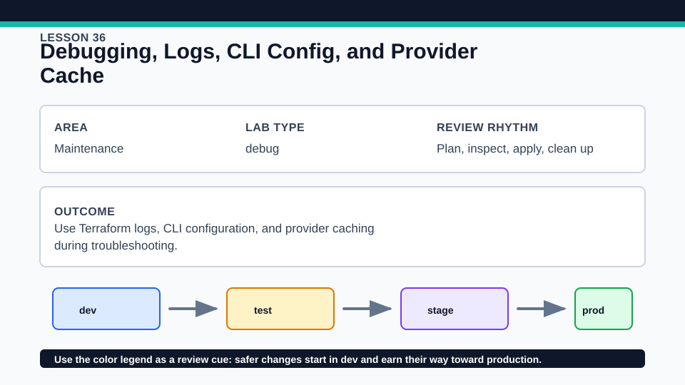
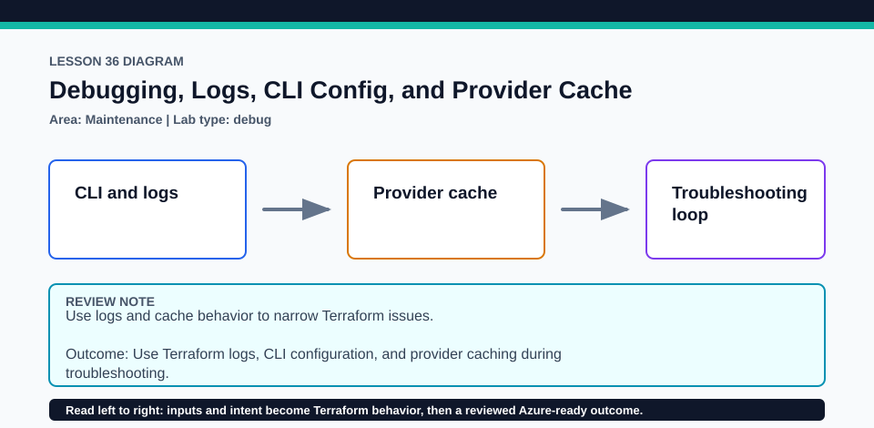

# Lesson 36: Debugging, Logs, CLI Config, and Provider Cache

Verbose logging is temporary diagnostic evidence, not a normal CI artifact.

## Certification alignment

- `2a` — Install and version Terraform providers — **guided**: Invoke-DebugDemo.ps1 exercises TF_LOG, TF_LOG_PATH, TF_CLI_CONFIG_FILE, and plugin_cache_dir in a disposable directory, redacts likely secrets, and cleans every artifact in finally.
- `7c` — Describe when and how to use verbose logging — **hands-on**: Invoke-DebugDemo.ps1 exercises TF_LOG, TF_LOG_PATH, TF_CLI_CONFIG_FILE, and plugin_cache_dir in a disposable directory, redacts likely secrets, and cleans every artifact in finally.

## Scenario

A CI job has slow provider installs and the team needs a focused, safe debug procedure.

## Walkthrough

1. Review exercise/Invoke-DebugDemo.ps1 and identify every process environment variable it saves and restores.
2. Run ./exercise/Invoke-DebugDemo.ps1 at DEBUG; use TRACE only when the narrower log is insufficient.
3. Inspect the temporary CLI configuration and plugin cache behavior, then review only the script's redacted diagnostic excerpt.
4. Confirm the script deletes its log, cache, CLI config, and temporary root even when a Terraform command fails.

Baseline commands for this lesson:

```powershell
Set-Location lab
terraform init -lockfile=readonly
terraform validate
terraform plan
```

## Expected results

- The diagnostic run creates a scoped log through TF_LOG_PATH and uses a temporary plugin cache.
- Likely secret patterns are redacted before any excerpt is displayed.
- The process environment and filesystem are restored by the finally block.

## Failure modes

- TRACE can expose provider requests, responses, paths, and sensitive values.
- A nonexistent or unwritable plugin_cache_dir makes initialization warn or fail to cache.
- Leaving TF_CLI_CONFIG_FILE set can silently change later Terraform runs.

## Wiki




## Cleanup

- Let the script finish so finally restores prior environment variables and removes the temporary directory.
- If interrupted, clear TF_LOG, TF_LOG_PATH, and TF_CLI_CONFIG_FILE and delete the identified temporary debug root manually.
- Never commit or share a raw Terraform log; keep the root dependency lock.
- Remove generated `.terraform/`, plan files, state files, debug logs, copied `terraform.tfvars`, and generated secrets only after any required destroy or migration is complete.
- If this root has a committed `.terraform.lock.hcl`, keep it. Never delete a root lock file as routine cleanup; update it only during an intentional, reviewed dependency upgrade.
- Do not commit credentials, real secret values, state, plan files, backend credentials, or local variable files.

## Check questions

1. Which log level is the narrowest one that captures the problem?
2. Why must TF_LOG_PATH output be treated as sensitive?
3. How does plugin_cache_dir improve speed without replacing the lock file?

