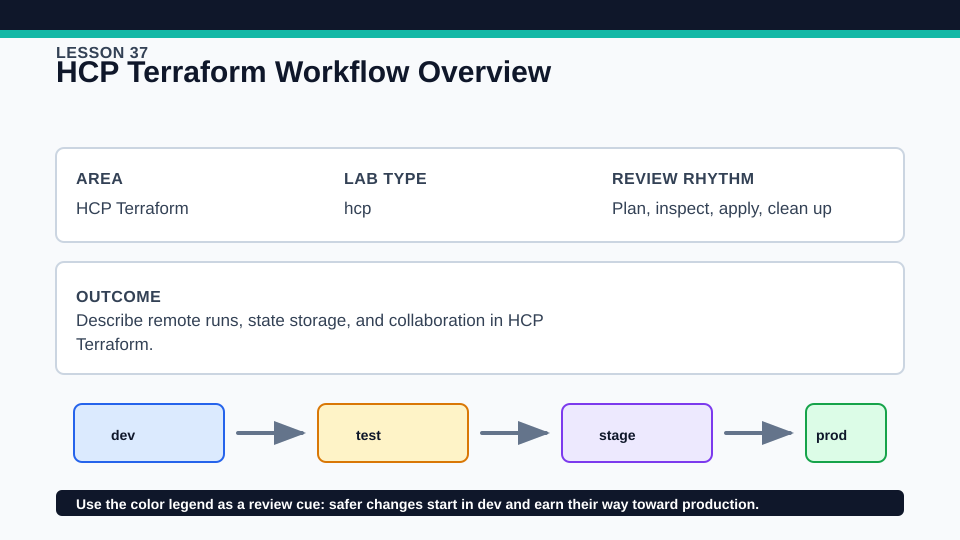
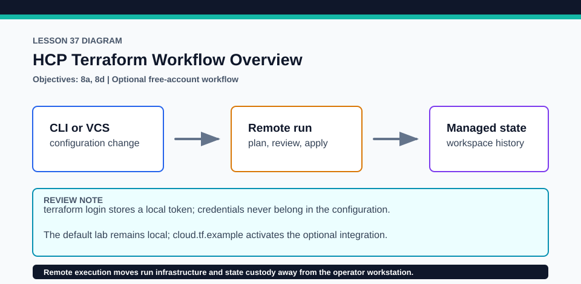

# Lesson 37: HCP Terraform Workflow Overview

HCP account work is optional; the lesson has a complete local validation path.

## Certification alignment

- `8a` — Use HCP Terraform to create infrastructure — **hands-on**: The optional cloud.tf.example supports terraform login, remote initialization, a no-cost workspace run, managed state, and cleanup; collaboration and paid-tier capabilities are labeled separately.
- `8b` — Describe HCP Terraform collaboration and governance features — **guided**: The optional cloud.tf.example supports terraform login, remote initialization, a no-cost workspace run, managed state, and cleanup; collaboration and paid-tier capabilities are labeled separately.
- `8d` — Configure and use HCP Terraform integration — **hands-on**: The optional cloud.tf.example supports terraform login, remote initialization, a no-cost workspace run, managed state, and cleanup; collaboration and paid-tier capabilities are labeled separately.

## Scenario

The platform team compares workstation runs with an optional HCP Terraform remote-run workflow.

## Walkthrough

1. Run the local baseline first to understand the same terraform_data configuration with local execution.
2. Optionally create a free HCP Terraform account and workspace, run terraform login, and copy cloud.tf.example to cloud.tf only in a disposable copy with your organization and workspace names.
3. Run init, plan, and apply so execution and state move to the HCP workspace; inspect the remote run log and state version.
4. Destroy through the HCP workspace, verify state is clean, remove the disposable copy, and compare remote collaboration with the local workflow.

Baseline commands for this lesson:

```powershell
Set-Location lab
terraform init -lockfile=readonly
terraform validate
terraform plan
```

The local validation path requires no HCP account. Any HCP Terraform procedure below is **optional**, uses an external account, and must be cleaned up in that account when complete.

## Expected results

- The account-free path validates and plans locally.
- The optional path queues an HCP Terraform run and stores state versions in the selected workspace.
- Run history separates configuration, plan, apply, logs, and user actions without requiring a paid policy feature.

## Failure modes

- A token for the wrong hostname or organization prevents initialization.
- A workspace Terraform version that differs from the course baseline can produce inconsistent results.
- Deleting the HCP workspace before destroy can strand infrastructure or obscure managed state.

## Wiki




## Cleanup

- For optional HCP use, run terraform destroy remotely and confirm the workspace state has no managed infrastructure.
- Remove the disposable cloud configuration, delete the training workspace/project if no longer needed, and revoke unneeded local API tokens.
- Remove generated `.terraform/`, plan files, state files, debug logs, copied `terraform.tfvars`, and generated secrets only after any required destroy or migration is complete.
- If this root has a committed `.terraform.lock.hcl`, keep it. Never delete a root lock file as routine cleanup; update it only during an intentional, reviewed dependency upgrade.
- Do not commit credentials, real secret values, state, plan files, backend credentials, or local variable files.

## Check questions

1. Which work moves from the workstation into HCP Terraform?
2. Where is state stored after remote initialization?
3. Which collaboration features are core, and which may depend on a paid tier?

