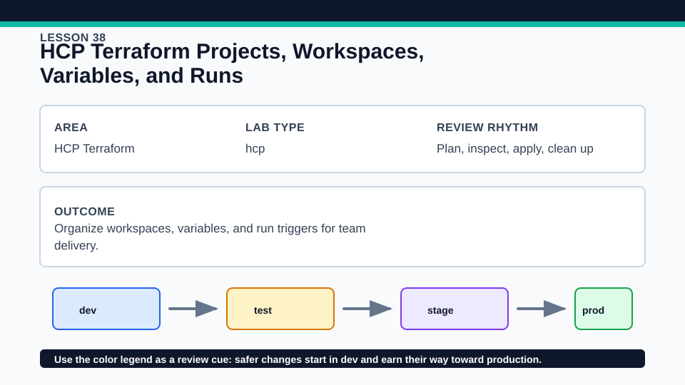
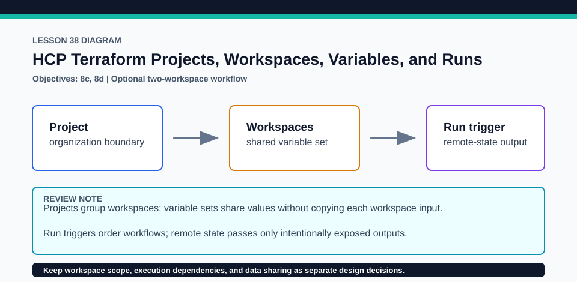

# Lesson 38: HCP Terraform Projects, Workspaces, Variables, and Runs

The hands-on HCP path is optional and must use a disposable project with authorized organization access.

## Certification alignment

- `8b` — Describe HCP Terraform collaboration and governance features — **guided**: Optional TFE configuration creates a project plus network and app workspaces; the exercise demonstrates remote-state consumption and a network-to-app run trigger.
- `8c` — Describe how to organize and use HCP Terraform workspaces and projects — **hands-on**: Optional TFE configuration creates a project plus network and app workspaces; the exercise demonstrates remote-state consumption and a network-to-app run trigger.
- `8d` — Configure and use HCP Terraform integration — **hands-on**: Optional TFE configuration creates a project plus network and app workspaces; the exercise demonstrates remote-state consumption and a network-to-app run trigger.

## Scenario

Multiple application teams need a project layout, shared variables, managed state, and an explicit network-to-application dependency.

## Walkthrough

1. Validate the local model, then inspect lab/hcp-setup.tf.example without enabling it and identify the project, two workspaces, remote-state consumer, and run trigger.
2. Review exercise/network and exercise/app cloud examples and trace the specific output the app consumes.
3. Optionally, in an authorized disposable HCP organization, configure the TFE provider outside source control and apply the setup example.
4. Run the network workspace, verify the successful apply queues the app run, and distinguish run-trigger ordering from remote-state data access.

Baseline commands for this lesson:

```powershell
Set-Location lab
terraform init -lockfile=readonly
terraform validate
terraform plan
```

The local validation path requires no HCP account. Any HCP Terraform procedure below is **optional**, uses an external account, and must be cleaned up in that account when complete.

## Expected results

- The local path documents the intended topology without an account.
- Optional setup creates one project with separate network and app workspace state and a directed run trigger.
- The app reads only the explicitly shared network output rather than another workspace's entire internal configuration.

## Failure modes

- A run trigger does not by itself grant permission to read remote state.
- Circular triggers or overly broad remote-state sharing create fragile coupling.
- Applying the TFE setup in the wrong organization can create or modify real administrative objects.

## Wiki




## Cleanup

- Destroy any infrastructure in app before network, then remove the optional run trigger and training workspaces through the owning setup root.
- Delete disposable cloud files and revoke temporary tokens; do not remove shared organization resources you do not own.
- Remove generated `.terraform/`, plan files, state files, debug logs, copied `terraform.tfvars`, and generated secrets only after any required destroy or migration is complete.
- If this root has a committed `.terraform.lock.hcl`, keep it. Never delete a root lock file as routine cleanup; update it only during an intentional, reviewed dependency upgrade.
- Do not commit credentials, real secret values, state, plan files, backend credentials, or local variable files.

## Check questions

1. What does the run trigger do that remote-state access does not?
2. Why place network and app state in separate workspaces?
3. Which variables belong in a shared variable set versus one workspace?

