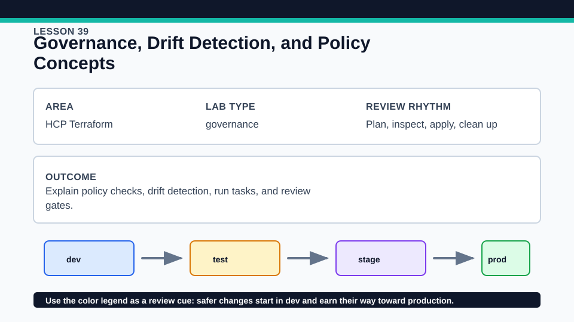
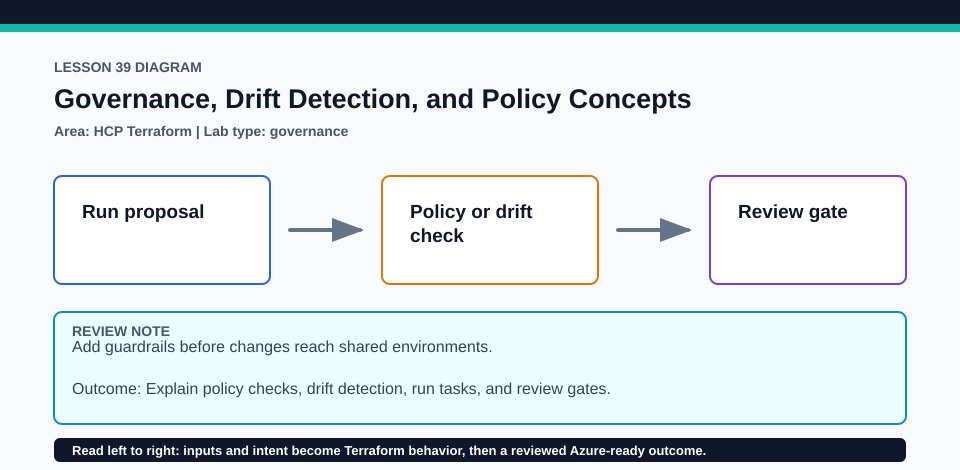

# Lesson 39: Governance, Drift Detection, and Policy Concepts

No paid feature is required to complete the active lab; optional cloud work needs an external account and authorization.

## Certification alignment

- `6d` — Manage resource drift and Terraform state — **guided**: The active local model and guided HCP review cover drift, health, policy, run tasks, projects, and approvals; an optional Azure resource-group extension uses HCP dynamic credentials without a client secret.
- `8b` — Describe HCP Terraform collaboration and governance features — **conceptual**: The active local model and guided HCP review cover drift, health, policy, run tasks, projects, and approvals; an optional Azure resource-group extension uses HCP dynamic credentials without a client secret.
- `8c` — Describe how to organize and use HCP Terraform workspaces and projects — **conceptual**: The active local model and guided HCP review cover drift, health, policy, run tasks, projects, and approvals; an optional Azure resource-group extension uses HCP dynamic credentials without a client secret.

## Scenario

Compliance reviewers want drift evidence and policy decisions before production infrastructure changes.

## Walkthrough

1. Run the account-free model and classify each governance capability as local, HCP core, or plan-dependent.
2. Review cloud.tf.example, azure-dynamic-credentials.tf.example, and hcp-environment-variables.example without adding secrets.
3. Optionally configure HCP workload identity for Azure, run the resource-group plan with dynamic credentials, and verify no static ARM_CLIENT_SECRET is present.
4. Walk through a detected-drift decision: accept with refresh-only state update, correct through configuration, or escalate ownership; then place policy and approval checks around the chosen run.

Baseline commands for this lesson:

```powershell
Set-Location lab
terraform init -lockfile=readonly
terraform validate
terraform plan
```

The local validation path requires no HCP account. Any HCP Terraform procedure below is **optional**, uses an external account, and must be cleaned up in that account when complete.

## Expected results

- Local outputs provide a governance decision model with no external account.
- The optional Azure run obtains short-lived credentials through HCP/Azure trust and creates only the reviewed resource group.
- Paid policy or advanced governance features remain guided and are not presented as available on every tier.

## Failure modes

- Dynamic credentials fail when Azure federated identity, audience, tenant, or subscription settings do not match.
- Drift detection identifies differences but does not decide whether configuration or the remote object is authoritative.
- A policy pass does not replace human review of cost, security, and destructive plan actions.

## Wiki




## Cleanup

- For optional Azure/HCP use, destroy the resource group through the same workspace before removing its dynamic-credential trust.
- Delete the disposable workspace/project and revoke temporary access only when you own them; keep guided examples tracked and secret-free.
- Remove generated `.terraform/`, plan files, state files, debug logs, copied `terraform.tfvars`, and generated secrets only after any required destroy or migration is complete.
- If this root has a committed `.terraform.lock.hcl`, keep it. Never delete a root lock file as routine cleanup; update it only during an intentional, reviewed dependency upgrade.
- Do not commit credentials, real secret values, state, plan files, backend credentials, or local variable files.

## Check questions

1. What choices follow a drift finding?
2. How do dynamic credentials avoid a long-lived client secret?
3. Which governance features are conceptual or plan-dependent in this lesson?

