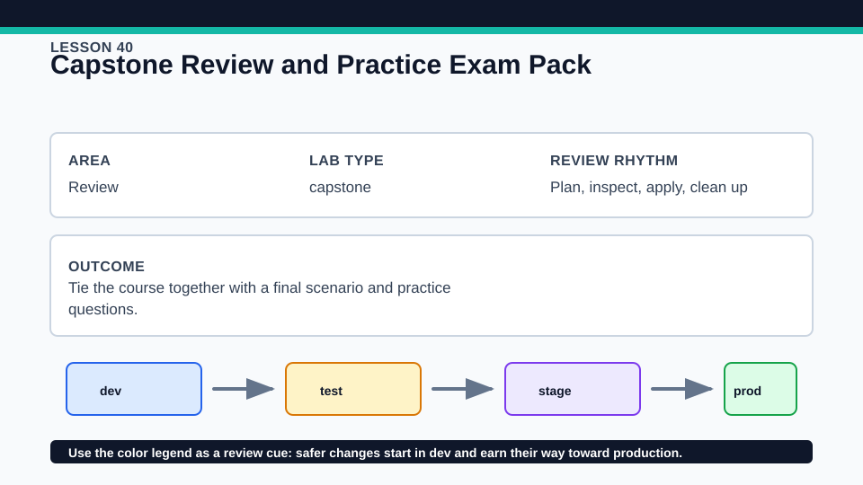
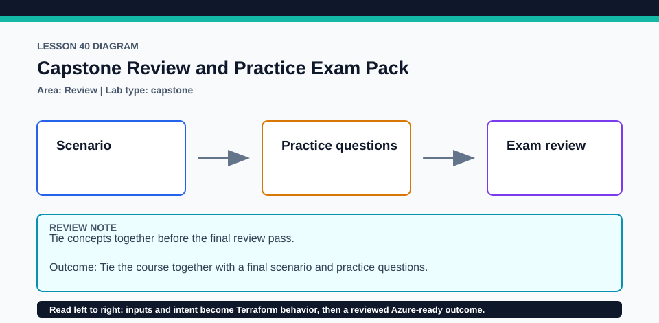

# Lesson 40: Capstone Review and Practice Exam Pack

Use the official content list and sample formats as authority; this original bank is supplementary study material.

## Certification alignment

- `3a` — Describe the Terraform workflow — **guided**: Two original 30-question sets exercise plan review and objective recall; the lesson makes no unofficial claim about the live exam's question count or passing score.
- `3d` — Generate and review an execution plan for Terraform — **guided**: Two original 30-question sets exercise plan review and objective recall; the lesson makes no unofficial claim about the live exam's question count or passing score.

## Scenario

A learner is preparing by mapping practical decisions back to every official Terraform Associate 004 objective.

## Walkthrough

1. Read the [objective map](../../exam-review/objective-map.md) and mark each objective as explain, demonstrate, or revisit.
2. Complete [Practice set A](../../exam-review/practice-questions.md#practice-set-a) before opening answer sections, then record objective IDs that need review.
3. Repeat with [Practice set B](../../exam-review/practice-questions.md#practice-set-b) and revisit the linked lessons rather than memorizing option letters.
4. Use the [open-ended study checks](../../exam-review/study-checks.md) for spoken or written recall, then run the local capstone plan and explain every action.

Baseline commands for this lesson:

```powershell
Set-Location lab
terraform init -lockfile=readonly
terraform fmt -check
terraform validate
terraform plan
```

## Expected results

- Each practice set contains 30 questions: 5 true/false, 15 single-choice, and 10 multiple-answer.
- Across the bank, all 37 official objectives plus ephemeral values and write-only arguments are represented.
- The local capstone validates without Azure or HCP credentials.

## Failure modes

- Treating a practice result as an official passing threshold creates false confidence.
- Memorizing answer positions does not demonstrate the ability to review a plan or explain state behavior.
- Skipping weak objective IDs because Azure examples feel familiar leaves provider-neutral gaps.

## Wiki




## Cleanup

- Destroy the local capstone contract if applied and remove its generated state afterward.
- Keep your personal study notes outside tracked course answers if they contain account or environment information.
- Remove generated `.terraform/`, plan files, state files, debug logs, copied `terraform.tfvars`, and generated secrets only after any required destroy or migration is complete.
- If this root has a committed `.terraform.lock.hcl`, keep it. Never delete a root lock file as routine cleanup; update it only during an intentional, reviewed dependency upgrade.
- Do not commit credentials, real secret values, state, plan files, backend credentials, or local variable files.

## Check questions

1. Which three objectives still need hands-on repetition?
2. Can you explain every incorrect distractor, not only the correct option?
3. Which 004 additions change how transient secrets can persist?

